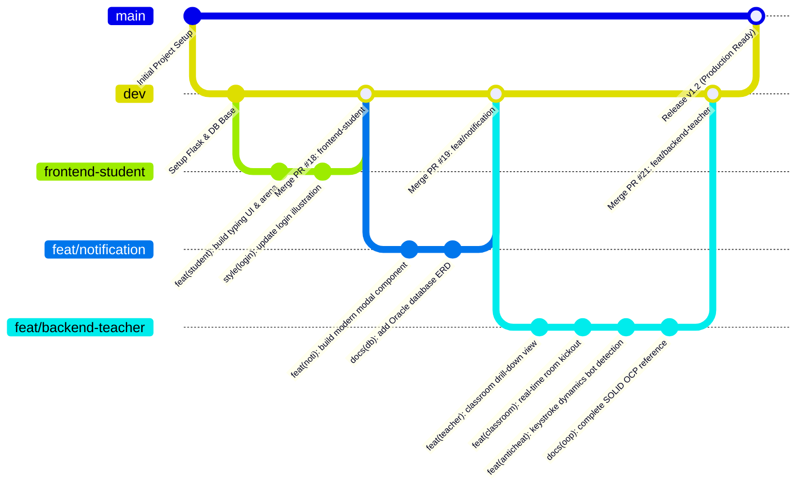
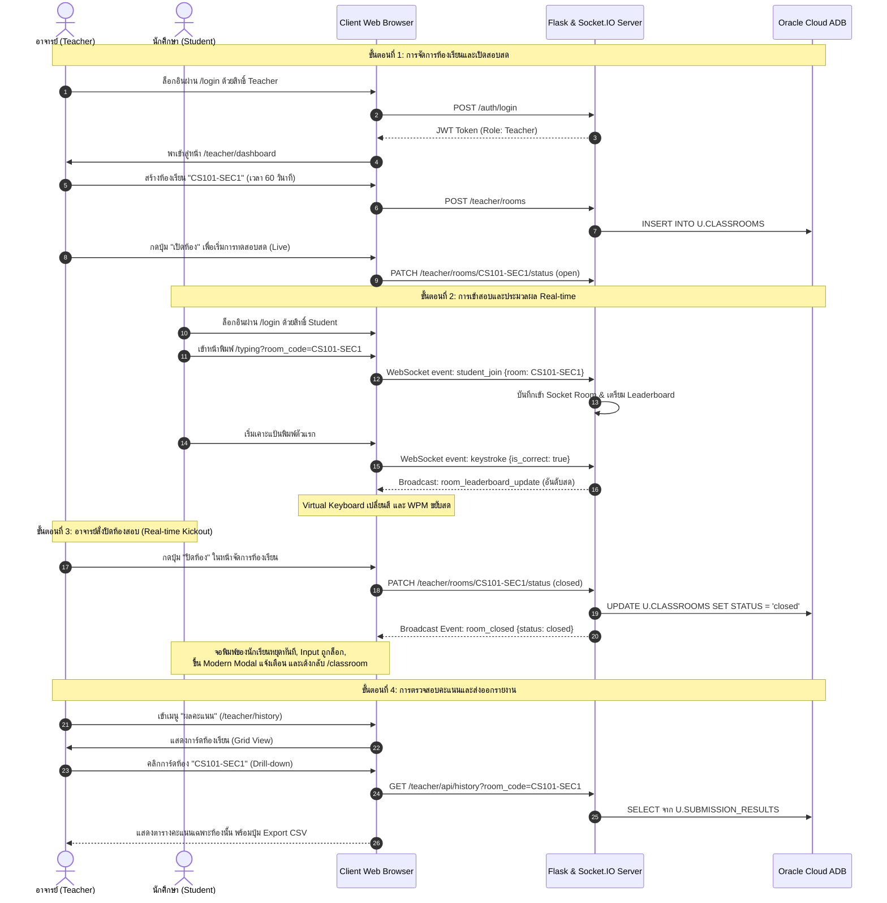

# เอกสารสรุปเนื้อหาโครงงานสำหรับการประเมินผล (อาจารย์ไพบูลย์)
## วิชา: SOFTWARE DESIGN AND DEVELOPMENT 2 (SDD 2)
### โครงงาน: TypeClass — ระบบห้องเรียนฝึกพิมพ์ดีดและวัดผลออนไลน์ (Typing Skill Assessment for Classroom)

---

## 📑 สารบัญการนำเสนอ
1. [บทนำและเป้าหมายของระบบ (Introduction & Scope)](#1-บทนำและเป้าหมายของระบบ-introduction--scope)
   - 1.1 ความสำคัญและความเป็นมาของปัญหา
   - 1.2 วัตถุประสงค์ของโครงงาน
   - 1.3 ขอบเขตและความสามารถของระบบ (Scope & Capabilities)
2. [สถาปัตยกรรมและการออกแบบระบบ (Architecture & Class Design)](#2-สถาปัตยกรรมและการออกแบบระบบ-architecture--class-design)
   - 2.1 ภาพรวมสถาปัตยกรรม (Layered Architecture & Component Diagram)
   - 2.2 Class Diagram และความสัมพันธ์ระหว่างวัตถุ (OOP Relationships)
   - 2.3 การประยุกต์ใช้ SOLID Principles เพื่อให้เกิด High Cohesion & Low Coupling
3. [การทำงานร่วมกันผ่าน Git (Team Collaboration Workflow)](#3-การทำงานร่วมกันผ่าน-git-team-collaboration-workflow)
   - 3.1 Branching Strategy ที่ใช้ (Feature Branching Workflow)
   - 3.2 ตัวอย่าง Commit History, Pull Requests และการทำ Code Review
4. [การสาธิตการทำงานของโปรแกรม (Live Demo Guidelines)](#4-การสาธิตการทำงานของโปรแกรม-live-demo-guidelines)
   - 4.1 ขั้นตอนแสดง Use Case หลักตามขีดความสามารถของระบบ
   - 4.2 การจัดการ Error และ Edge Cases สำคัญ
5. [สรุปผลและข้อเสนอแนะ (Conclusion & Refactoring Opportunities)](#5-สรุปผลและข้อเสนอแนะ-conclusion--refactoring-opportunities)
   - 5.1 ปัญหาและอุปสรรคในการออกแบบเชิงวัตถุ
   - 5.2 สิ่งที่สามารถพัฒนาต่อยอดได้ในอนาคต

---

## 1. บทนำและเป้าหมายของระบบ (Introduction & Scope)

### 1.1 ความสำคัญและความเป็นมาของปัญหา (Problem Statement)
ในปัจจุบัน แพลตฟอร์มฝึกพิมพ์ดีดภาษาอังกฤษออนไลน์ที่มีอยู่อย่างแพร่หลาย (เช่น Monkeytype, 10FastFingers, Keybr) ถูกพัฒนาขึ้นเพื่อ **"การฝึกฝนส่วนบุคคล (Personal Practice)"** เป็นหลัก ทำให้เมื่อนำมาใช้ในการเรียนการสอนในชั้นเรียนจริง จึงเกิดปัญหาสำคัญดังนี้:
1. **ขาดระบบควบคุมสำหรับผู้สอน (No Teacher Management):** อาจารย์ไม่สามารถกำหนดโจทย์เนื้อหาเฉพาะทางที่สอดคล้องกับบทเรียน ไม่สามารถตั้งเวลาสอบพร้อมกัน และไม่สามารถควบคุมการเปิด-ปิดห้องสอบได้
2. **ช่องโหว่ด้านการทุจริตและการปลอมแปลงคะแนน (High Fraud Risk):** การส่งผลคะแนนแบบเดิมมักให้นักศึกษาถ่ายภาพหน้าจอ (Screenshot) ซึ่งสามารถตกแต่งภาพ หรือแก้ไขค่าตัวเลขบน DOM (Inspect Element) ได้อย่างง่ายดาย อาจารย์ไม่มีหลักฐานยืนยันความเร็ว (WPM) และความแม่นยำที่แท้จริง
3. **ขาดศูนย์รวมข้อมูลและการวิเคราะห์ผล (Scattered Data):** ข้อมูลผลการพิมพ์ไม่ได้ถูกจัดเก็บลงฐานข้อมูลอย่างเป็นระบบ ทำให้อาจารย์ไม่สามารถติดตามพัฒนาการรายบุคคล และไม่สามารถวิเคราะห์จุดอ่อนของนักศึกษาทั้งห้องเรียนได้

จากปัญหาดังกล่าว ทีมงานจึงได้พัฒนา **TypeClass** ระบบห้องเรียนฝึกพิมพ์ดีดที่ออกแบบเพื่อชั้นเรียนโดยเฉพาะ โดยให้อาจารย์เป็นเจ้าของข้อมูลและศูนย์กลางการจัดการอย่างแท้จริง

---

### 1.2 วัตถุประสงค์ (Objectives)
* **ความโปร่งใสและตรวจสอบได้ (Authentic & Transparent Assessment):** ผลการพิมพ์ทุกตัวอักษรถูกคำนวณผ่านระบบฝั่ง Server และบันทึกประวัติลงฐานข้อมูล Oracle Autonomous Database บน Cloud แบบ Real-time
* **การควบคุมและจัดการห้องเรียนแบบรวมศูนย์ (Classroom Control):** อาจารย์สามารถสร้างห้องเรียน เปิด/ปิดห้องสอบ ดีดนักศึกษาออกจากห้องเมื่อหมดเวลาสอบ และดูตารางคะแนนสด (Live Leaderboard) ได้ทันที
* **การออกแบบซอฟต์แวร์คุณภาพสูงตามหลัก OOP & SOLID:** ประยุกต์ใช้แนวคิดเชิงวัตถุ การแบ่งชั้นสถาปัตยกรรม (Layered Architecture) และหลักการ Open/Closed Principle เพื่อให้ระบบมีความยืดหยุ่น รองรับการขยายโหมดการพิมพ์ใหม่ในอนาคต

---

### 1.3 ขอบเขตการทำงาน (Scope & Capabilities)

| ขอบเขตงาน (Module) | บทบาทที่เกี่ยวข้อง | ขีดความสามารถหลัก (Key Capabilities) |
|---|:---:|---|
| **ระบบยืนยันตัวตน (Unified Authentication)** | ทุกคน | • ล็อกอินผ่านหน้าเดียว (`/login`) แต่แยก Role อัตโนมัติ (`Student` / `Teacher`)<br>• รองรับ Google OAuth 2.0 ล็อกอินด้วยบัญชีสถาบัน<br>• ระบบความปลอดภัยสองชั้น (JWT Token + HTTPOnly Cookies + Client Guard) |
| **ระบบจัดการห้องเรียน (Classroom Management)** | อาจารย์ | • สร้างห้องเรียนใหม่ กำหนดระยะเวลาสอบ (Duration)<br>• ควบคุมสถานะห้องสอบแบบสด (`Open` / `Closed`)<br>• **Real-time Room Kickout:** เมื่ออาจารย์ปิดห้อง นักศึกษาที่กำลังพิมพ์จะถูกล็อกหน้าจอและดีดออกจากห้องสอบทันที |
| **ระบบจัดการนักศึกษา (Student Drill-down)** | อาจารย์ | • **2-Level Navigation:** แสดงการ์ดห้องเรียนสรุปจำนวนนักศึกษา เมื่อคลิกจะเจาะลึก (Drill-down) เข้าดูรายชื่อนักศึกษาเฉพาะห้องนั้นได้ทันที<br>• ค้นหารหัสนักศึกษาและชื่อ-นามสกุลแบบ Real-time |
| **ระบบรายงานผลและตรวจจับบอท (Analytics & History)** | อาจารย์ | • รายงานผลคะแนนแยกรายห้อง พร้อมคำนวณ Best WPM, Avg WPM, Avg Accuracy<br>• ส่งออกรายงานคะแนนเป็นไฟล์ **CSV Export**<br>• **Anti-Bot Alert Tag:** แสดงป้ายเตือนสีแดง `⚠️ ตรวจพบบอท` พร้อม Tooltip บอกสาเหตุ |
| **สนามฝึกพิมพ์และแข่งขัน (Typing Arena)** | นักศึกษา | • จำลองแป้นพิมพ์ Virtual Keyboard ตอบสนองการกดแป้นสดแบบ Real-time<br>• โหมดฝึกซ้อมส่วนตัว (Practice) และโหมดสอบในห้องเรียน (Exam Mode)<br>• ตารางอันดับคะแนนสดในห้องเรียน (In-Room Live Leaderboard) ผ่าน WebSocket |
| **ระบบป้องกันการโกงและตรวจจับบอท (Anti-Cheat Engine)** | ระบบ | • ตรวจสอบ `event.isTrusted` (ดักจับสคริปต์ DOM Injection และ Console Bots)<br>• ป้องกันการวางข้อความ (Paste Blocked) และการแทรกข้อความหลายตัวพร้อมกัน (Bulk Input)<br>• วิเคราะห์ **Keystroke Dynamics (IKI Uniformity $\sigma < 3.5\text{ ms}$)**<br>• เพดานความเร็วมนุษย์สูงสุดที่ 240 WPM (หากเกินจะปรับคะแนนเป็น 0 ทันที) |

---

## 2. สถาปัตยกรรมและการออกแบบระบบ (Architecture & Class Design)

### 2.1 ภาพรวมสถาปัตยกรรม (Layered Architecture & Component Diagram)
ระบบ TypeClass ถูกออกแบบตามสถาปัตยกรรมแบบแบ่งชั้น (**Layered Architecture**) เพื่อให้แต่ละส่วนแยกหน้าที่อย่างอิสระ (Separation of Concerns):

```mermaid
flowchart TD
    subgraph PresentationLayer ["1. Presentation Layer (Frontend Client)"]
        UI_Student["Student UI (Jinja2 / CSS / JS)"]
        UI_Teacher["Teacher UI (Jinja2 / CSS / JS)"]
        AntiBot_Client["Anti-Bot Engine (Keystroke Dynamics)"]
        Modal_Client["Modern Modal Notification Module"]
        Guard_Client["Client Auth Guard (auth_guard.js)"]
    end

    subgraph TransportLayer ["2. Transport & Controller Layer (Flask Gateway)"]
        HTTP_Auth["Auth Blueprint (/auth)"]
        HTTP_Student["Student Blueprint (/api/student)"]
        HTTP_Teacher["Teacher Blueprint (/teacher)"]
        Socket_Gateway["Flask-SocketIO Gateway (WebSocket Server)"]
        Route_Guards["Dual-Layer Route Guards (@require_role)"]
    end

    subgraph ServiceLayer ["3. Business Logic & Service Layer"]
        Typing_Svc["TypingService (Session & Live Leaderboard)"]
        AntiCheat_Validator["Anti-Cheat & Keystroke Dynamics Engine"]
        Storage_Svc["StorageService (Avatar Uploads)"]
    end

    subgraph ModelLayer ["4. Domain Model Layer (OOP & SOLID)"]
        BaseTypingMode["BaseTypingMode (Abstract Base Class)"]
        StandardTypingSession["StandardTypingSession (Concrete Class)"]
        DomainEntities["Domain Entities (User, Student, Teacher, Classroom)"]
    end

    subgraph PersistenceLayer ["5. Data Persistence Layer (Database)"]
        DB_Connector["app/database.py (Oracle Connection Handler)"]
        Oracle_Cloud[("Oracle Autonomous Database (ADB Cloud)")]
    end

    UI_Student --> Guard_Client
    UI_Teacher --> Guard_Client
    Guard_Client --> HTTP_Student
    Guard_Client --> HTTP_Teacher
    UI_Student <--> Socket_Gateway
    UI_Teacher <--> Socket_Gateway

    HTTP_Auth --> Route_Guards
    HTTP_Student --> Route_Guards
    HTTP_Teacher --> Route_Guards

    Route_Guards --> ServiceLayer
    Socket_Gateway --> ServiceLayer

    ServiceLayer --> ModelLayer
    ModelLayer -.-> BaseTypingMode
    BaseTypingMode <|-- StandardTypingSession

    ServiceLayer --> DB_Connector
    HTTP_Student --> DB_Connector
    HTTP_Teacher --> DB_Connector
    DB_Connector --> Oracle_Cloud
```

---

### 2.2 Class Diagram และความสัมพันธ์ระหว่างวัตถุ (OOP Relationships)

```mermaid
classDiagram
    %% Inheritance ในส่วนผู้ใช้งาน (Domain Entities)
    class User {
        +int user_id
        +string username
        +string email
        +string role
        +string full_name
        +is_student(): bool
        +is_teacher(): bool
        +to_dict(): dict
    }

    class Student {
        +string student_code
        +string major
        +to_dict(): dict
    }

    class Teacher {
        +string academic_title
        +string faculty
        +to_dict(): dict
    }

    User <|-- Student : Inheritance (IS-A)
    User <|-- Teacher : Inheritance (IS-A)

    %% โครงสร้างเอนทิตีห้องเรียนและการส่งงาน
    class Classroom {
        +int room_id
        +string room_code
        +string room_name
        +int teacher_id
        +string status
        +int duration
        +is_active(): bool
    }

    class SubmissionResult {
        +int result_id
        +int assignment_id
        +int student_id
        +float wpm
        +float accuracy
        +float time_spent
        +int error_count
        +float score
        +string teacher_comment
    }

    Teacher "1" --> "0..*" Classroom : Owns
    Classroom "1" --> "0..*" Student : Has Members (N:M)
    Student "1" --> "0..*" SubmissionResult : Submits
    Classroom "1" --> "0..*" SubmissionResult : Contains

    %% หัวใจสำคัญของ OOP: Typing Engine
    class BaseTypingMode {
        <<abstract>>
        #string _target_text
        #datetime _start_time
        #datetime _end_time
        #int _total_chars_typed
        #int _correct_chars
        #bool _is_completed
        #bool _is_flagged
        #string _flag_reason
        #list _keystroke_timestamps
        +start_session()
        +process_keystroke(is_correct: bool)
        +get_current_stats(): dict
        +calculate_score()* int
    }

    class StandardTypingSession {
        +calculate_score(): int
        +finalize_session(): dict
    }

    class SuddenDeathTypingSession {
        +process_keystroke(is_correct: bool)
        +calculate_score(): int
    }

    BaseTypingMode <|-- StandardTypingSession : Inheritance (Polymorphism)
    BaseTypingMode <|-- SuddenDeathTypingSession : Future Extension (OCP)

    %% Service ที่นำ Model ไปใช้งาน
    class TypingService {
        -dict active_sessions
        -dict room_leaderboards
        +register_user_session(sid, user_id, username)
        +join_room(sid, room_code)
        +start_typing_session(sid): string
        +process_keystroke(sid, is_correct): tuple
        +submit_score(sid, data): tuple
        +remove_session(sid)
    }

    TypingService o-- BaseTypingMode : Aggregates / Controls
```

---

### 2.3 การประยุกต์ใช้ SOLID Principles เพื่อให้เกิด High Cohesion & Low Coupling

#### 1. High Cohesion & Low Coupling
* **High Cohesion (ความเกาะกลุ่มภายในสูง):** แต่ละคลาสรับผิดชอบเพียงขอบเขตหน้าที่ของตนเองอย่างชัดเจน
  * คลาส `StandardTypingSession` ดูแลเฉพาะการคำนวณสถิติและ Keystroke dynamics ของผู้ใช้คนเดียวในหนึ่งรอบพิมพ์
  * คลาส `TypingService` ดูแลเฉพาะตรรกะการบริหารจัดการเซสชันและตารางอันดับสด (Leaderboard) ระหว่างผู้ใช้หลายคน
  * โมดูล `app/database.py` ดูแลเฉพาะการสร้าง Connection ไปยัง Oracle Cloud เท่านั้น
* **Low Coupling (การผูกมัดระหว่างส่วนประกอบต่ำ):** การทำงานระหว่างชั้น Controller (`events.py`), Service (`TypingService`) และ Model (`BaseTypingMode`) เชื่อมต่อกันผ่าน Public Method มาตรฐาน โดยไม่มีการยึดติดกับโครงสร้างภายในของคลาสอื่น

---

#### 2. ไฮไลต์โค้ดจุดสำคัญที่ 1: Open/Closed Principle (OCP)
> **หลักการ:** *"Software entities should be open for extension, but closed for modification."*

* **Closed for Modification (ปิดกั้นต่อการแก้ไข):**
  คลาสแม่ `BaseTypingMode(ABC)` ใน [app/models/typing_session.py](file:///Users/povofwinter/Desktop/U/OOP-SDD2-type/app/models/typing_session.py) รวบรวมฟังก์ชันหัวใจสำคัญไว้ครบถ้วน เช่น การจับเวลา, การนับสถิติ, และอัลกอริทึมวิเคราะห์ Keystroke Dynamics สำหรับดักจับบอท โค้ดส่วนนี้ปิดกั้นไม่ให้ใครมาแก้โค้ดภายใน เพื่อไม่ให้กระทบโหมดเดิมที่เสถียรอยู่แล้ว
* **Open for Extension (เปิดกว้างต่อการขยายฟังก์ชัน):**
  คลาสแม่กำหนด Abstract Method:
  ```python
  @abstractmethod
  def calculate_score(self) -> int:
      """บังคับให้คลาสลูกเขียนสูตรคำนวณคะแนนตามโหมดของตนเอง"""
      pass
  ```
  หากในอนาคตต้องการเพิ่ม **โหมด Sudden Death** (พิมพ์ผิดตัวเดียวปรับคะแนนเป็น 0 ทันที) หรือ **โหมด Coding Syntax** (ถ่วงน้ำหนักอักขระพิเศษ `{`, `}`, `;`) ทีมพัฒนาสามารถสร้างคลาสใหม่มาสืบทอดจาก `BaseTypingMode` ได้ทันที **โดยไม่ต้องแก้ไขโค้ดเดิมในคลาสแม่แม้แต่บรรทัดเดียว!**

```python
# ตัวอย่างโค้ดจริงใน app/models/typing_session.py แสดง OCP & Polymorphism
class StandardTypingSession(BaseTypingMode):
    def calculate_score(self) -> int:
        # หากถูกระบบ Anti-Cheat ตั้งสถานะ Flagged ปรับคะแนนเป็น 0 ทันที
        if self._is_flagged:
            return 0
        stats = self.get_current_stats()
        final_score = stats["wpm"] * (stats["accuracy"] / 100) * 10
        return round(final_score)

# ตัวอย่างการขยายโหมดใหม่ในอนาคต (โดยไม่ต้องแก้ BaseTypingMode เดิม)
class SuddenDeathTypingSession(BaseTypingMode):
    def process_keystroke(self, is_correct: bool):
        super().process_keystroke(is_correct)
        if not is_correct:
            self._is_completed = True
            self._is_flagged = True
            self._flag_reason = "Game Over: พิมพ์ผิดในโหมด Sudden Death"

    def calculate_score(self) -> int:
        if self._is_flagged:
            return 0
        stats = self.get_current_stats()
        return round(stats["wpm"] * 20)  # โบนัสสำหรับความแม่นยำ 100%
```

---

#### 3. ไฮไลต์โค้ดจุดสำคัญที่ 2: Single Responsibility Principle (SRP) & Dependency Inversion (DIP)
* **SRP:** แยกการทำงานของ WebSocket Transport ออกจาก Business Logic อย่างเด็ดขาด:
  * ใน [app/sockets/events.py](file:///Users/povofwinter/Desktop/U/OOP-SDD2-type/app/sockets/events.py) ทำหน้าที่เพียงรับ Payload จากเครือข่าย แล้วส่งต่อไปให้ `typing_service.process_keystroke()` จากนั้นนำผลลัพธ์ที่ได้มา `emit` กระจายต่อ โดยไม่มีโค้ดคำนวณ WPM ปะปนอยู่ใน Socket Handler
* **DIP:** คลาสระดับสูง (`TypingService`) พึ่งพา Abstraction (`BaseTypingMode`) ในการสั่งเริ่มและจบเซสชัน และระบบฐานข้อมูลพึ่งพา Environment Variables ผ่าน `get_db_connection()` ทำให้สามารถสลับโหมดการเชื่อมต่อ (Thin/Thick Mode หรือ Test DB) ได้โดยไม่ต้องรื้อโค้ดใน Service Layer

---

## 3. การทำงานร่วมกันผ่าน Git (Team Collaboration Workflow)

### 3.1 Branching Strategy ที่ใช้ (Feature Branching Workflow)
ทีมงานประยุกต์ใช้แนวทางการแตกกิ่งแบบ **Git Feature Branching Strategy** ร่วมกับ Trunk-Based Development:



* **`main` (Production):** กิ่งหลักที่เก็บโค้ดที่เสถียรที่สุด พร้อมนำไปใช้งานจริงบน Server
* **`dev` (Integration):** กิ่งกลางสำหรับรวบรวมฟีเจอร์จากสมาชิกในทีม เพื่อทดสอบการทำงานร่วมกัน (System Integration Testing) และรัน CI/CD
* **Feature Branches (`feat/*`, `fix/*`):** กิ่งเฉพาะงานที่สมาชิกแต่ละคนแยกไปพัฒนา เช่น:
  * `feat/backend-teacher`: ดูแลระบบหลังบ้านอาจารย์, Classroom Drill-down, ปิดห้อง Real-time, และ Anti-Bot
  * `frontend-student`: ดูแลหน้าจอฝึกพิมพ์, กราฟิก, และการจัดวาง Layout นักเรียน
  * `feat/notification`: สร้างระบบแจ้งเตือน Modern Modal สไตล์การ์ดมน แทน `alert()` ดั้งเดิม
  * `fix/auth-route-guard`: ปรับปรุงระบบป้องกัน URL แอบเข้าหน้าเว็บ

---

### 3.2 ตัวอย่าง Commit History, Pull Requests และการทำ Code Review
* **มาตรฐานการตั้งชื่อ Commit (Conventional Commits):**
  * `feat(teacher): separate students and history views by classroom with drill-down navigation`
  * `feat(classroom): kick out typing students immediately with notification when room is closed`
  * `feat(anticheat): implement comprehensive anti-bot and keystroke dynamics detection`
  * `docs(db): add Oracle database ER diagram and data dictionary documentation`
  * `fix(ci): fix anti-cheat test assertion and handle non-oracledb exceptions in database connection`
* **ตัวอย่างการทำ Code Review & การแก้ปัญหา Merge Conflict:**
  * **กรณีศึกษา:** ตอนที่ Merge กิ่ง `dev` เข้าสู่ `frontend-student` เกิดข้อขัดแย้ง (Merge Conflict) ในไฟล์ [app/templates/student/login.html](file:///Users/povofwinter/Desktop/U/OOP-SDD2-type/app/templates/student/login.html) และ `database.py` เนื่องจากฝั่งหนึ่งปรับ UI ดีไซน์การเปิด-ปิดตารหัสผ่าน ขณะที่อีกฝั่งกำลังติดตั้งระบบ `auth_guard.js`
  * **แนวทางแก้ไข:** ทีมงานทำการ Review โค้ดแบบเคียงข้าง (Side-by-side Inspection) ผสานฟังก์ชันตรวจจับสถานะ Token ของ Auth Guard ไว้ที่ส่วนบนสุดของ Header และคงฟังก์ชัน UI Toggle ตาไว้ในส่วนฟอร์ม ทำให้สามารถผสานโค้ดทั้งสองฝั่งเข้าด้วยกันได้โดยไม่มีฟีเจอร์ใดสูญหาย
* **กระบวนการ Continuous Integration (CI):**
  ทุกครั้งที่มีการเปิด PR เข้าสู่ `dev` ระบบ **GitHub Actions** จะทำการตรวจสอบคุณภาพโค้ดอัตโนมัติ:
  1. ตรวจสอบ Linting ด้วย `flake8`
  2. รันชุดทดสอบ Unit Tests ด้วย `pytest app/test`
  ต้องผ่านเกณฑ์ 100% ถึงจะอนุญาตให้ Merge เข้ากิ่งหลักได้

---

## 4. การสาธิตการทำงานของโปรแกรม (Live Demo Guidelines)

### 4.1 ขั้นตอนแสดง Use Case หลักตามขีดความสามารถของระบบ (Live Demo Script)



---

### 4.2 การจัดการ Error และ Edge Cases สำคัญ
1. **การป้องกันเข้าห้องที่ปิดอยู่ (Prevent Closed Room Intrusion):**
   - หากนักเรียนพยายามกรอกรหัสห้องหรือพิมพ์ URL ตรงเข้าไปยังห้องที่อาจารย์ปิดแล้ว (`/typing?room_code=...`)
   - ระบบ [app/routes/student_routes.py](file:///Users/povofwinter/Desktop/U/OOP-SDD2-type/app/routes/student_routes.py) และ [app/sockets/events.py](file:///Users/povofwinter/Desktop/U/OOP-SDD2-type/app/sockets/events.py) จะตรวจสอบสถานะห้องในตาราง `U.CLASSROOMS`
   - ระบบจะตอบกลับด้วย **HTTP 403 Forbidden** และยิง Event `room_closed` ทันที พร้อมแสดง Modern Modal สีแดง: *"ห้องเรียนนี้ปิดการทดสอบแล้ว คุณไม่สามารถเข้าสอบได้"*
2. **การตรวจจับบอทและการพิมพ์อัตโนมัติ (Anti-Bot Keystroke Dynamics):**
   - **กรณี Paste ข้อความ:** ป้องกันและดักจับ Event `paste` / `drop` ช่องพิมพ์จะถูกล็อกทันที
   - **กรณี Console Script / Tampermonkey:** ตรวจสอบคุณสมบัติ `event.isTrusted` หากสร้างด้วยคำสั่ง JavaScript (ไม่ใช่การกดจากมือมนุษย์จริง) จะมีค่า `isTrusted === false` ระบบจะตัดสิทธิ์ทันที
   - **กรณี Auto-Typing Bot:** คำนวณค่าเบี่ยงเบนมาตรฐานของเวลาระหว่างการเคาะแป้น (IKI Uniformity) หาก $\sigma < 3.5\text{ ms}$ ติดต่อกัน 15 ตัวอักษร (มนุษย์จริงจะมี $\sigma > 15-35\text{ ms}$) ระบบจะ Flag ทันที
   - **ผลลัพธ์ในฐานข้อมูล:** ปรับเกรดเป็น **0 คะแนน** และบันทึกเหตุผลลง `TEACHER_COMMENT` ในหน้าจออาจารย์จะติดแท็กเด่นชัดว่า **`⚠️ ตรวจพบบอท`**
3. **การรับมือเมื่อฐานข้อมูล Cloud มีปัญหา (Database Exception Handling):**
   - ใน [app/database.py](file:///Users/povofwinter/Desktop/U/OOP-SDD2-type/app/database.py) ครอบด้วย `try...except Exception as e:` ครอบคลุมทั้งข้อผิดพลาด DNS, Connection Timeout และ Authentication
   - หากฐานข้อมูลมีปัญหา ระบบจะคืนค่า `None` อย่างปลอดภัย และ API จะส่ง HTTP 500 ตอบกลับอย่างเป็นมิตร โดยไม่ทำให้ Process หลักของเซิร์ฟเวอร์เกิด Crash
4. **การชนกันของพอร์ตบนระบบปฏิบัติการ (macOS Port 5000 Collision):**
   - บน macOS ฟังก์ชัน AirPlay Receiver จะยึดครองพอร์ต 5000 ไว้เป็นค่าเริ่มต้น
   - ใน [run.py](file:///Users/povofwinter/Desktop/U/OOP-SDD2-type/run.py) ได้เขียนระบบ Auto-Port Detection หากพบว่าพอร์ต 5000 มีเซอร์วิสจองอยู่ จะสลับมารันที่พอร์ต `5001` โดยอัตโนมัติ

---

## 5. สรุปผลและข้อเสนอแนะ (Conclusion & Refactoring Opportunities)

### 5.1 ปัญหาและอุปสรรคในการออกแบบเชิงวัตถุ (OOP Challenges Encountered)
1. **ความไม่สอดคล้องระหว่าง Web Stateless กับ Real-time Stateful (State Mismatch):**
   - สถาปัตยกรรมเว็บ HTTP แบบดั้งเดิมถูกออกแบบให้เป็น **Stateless (ไม่มีการจดจำสถานะข้าม Request)** ในขณะที่ระบบฝึกพิมพ์และ Live Leaderboard ต้องประมวลผลข้อมูลการเคาะแป้นหลายร้อยครั้งต่อนาทีแบบ **Stateful (เก็บสถานะสดในหน่วยความจำ)**
   - **แนวทางแก้ไข:** ออกแบบคลาส `TypingService` เป็น **Singleton Manager** ในหน่วยความจำ คอยผูกความสัมพันธ์ระหว่าง WebSocket Socket ID (`sid`) กับอ็อบเจกต์ `StandardTypingSession` อย่างเป็นระเบียบ และล้างหน่วยความจำทันทีเมื่อผู้ใช้ตัดการเชื่อมต่อ (`remove_session`)
2. **การแปลงข้อมูลเชิงวัตถุสู่ตารางฐานข้อมูลเชิงสัมพันธ์ (Object-Relational Mapping & Class-Table Inheritance):**
   - โครงสร้างคลาส `User` แตกแขนงเป็น `Student` และ `Teacher` ตามหลักการ OOP (Inheritance) แต่ในฐานข้อมูลเชิงสัมพันธ์ Oracle Database ต้องออกแบบในรูปแบบ **Class-Table Inheritance** (`U.USERS` เชื่อมโยง 1:1 กับ `U.STUDENTS` และ `U.TEACHERS` ด้วย `USER_ID`)
   - **แนวทางแก้ไข:** เขียนคำสั่ง Parameterized SQL ผ่าน Database Controller ให้ทำ Transaction แบบ Atomic (Insert ลงตารางหลักและตารางส่วนขยายพร้อมกันในหนึ่ง Commit) เพื่อรักษาความถูกต้องของข้อมูล (Data Integrity)
3. **การควบคุมการเข้าถึงและ Encapsulation ในภาษา Python:**
   - ภาษา Python ไม่มีคีย์เวิร์ด Private แท้จริงเหมือนภาษา Java/C#
   - **แนวทางแก้ไข:** ใช้หลักการตั้งชื่อ Private Variable ด้วย Leading Underscore (`_total_chars_typed`, `_is_flagged`) และเปิดให้เข้าถึงผ่าน Property Decorator (`@property`) เพื่อควบคุมการอ่าน-เขียนข้อมูลอย่างปลอดภัย

---

### 5.2 สิ่งที่สามารถพัฒนาต่อยอดได้ (Refactoring Opportunities & Future Extensibility)
1. **การประยุกต์ใช้ Repository Pattern (Data Access Refactoring):**
   - ปัจจุบันโค้ดคำสั่ง SQL บางส่วนยังคงอยู่ใน Controller/Routes
   - **แนวทางพัฒนา:** สามารถ Refactor โดยแยกส่วนคำสั่ง SQL ออกไปเป็น **Repository Classes** (เช่น `ClassroomRepository`, `SubmissionRepository`) เพื่อให้โค้ดส่วน Route มีหน้าที่รับ-ส่ง HTTP เพียงอย่างเดียวตามหลัก SRP และทำให้สามารถเขียน Mock Database ใน Unit Tests ได้สะดวกร้อยเปอร์เซ็นต์
2. **การนำ Strategy Pattern มาใช้คำนวณคะแนน (Scoring Algorithm Strategy):**
   - อาจารย์ผู้สอนอาจมีความต้องการคำนวณคะแนนที่แตกต่างกันในแต่ละการสอบ (เช่น สอบเน้นความเร็ว, สอบเน้นความแม่นยำ, หรือสอบพิมพ์โค้ด)
   - **แนวทางพัฒนา:** แยกอัลกอริทึมการคิดคะแนนออกมาเป็นคลาส Strategy (เช่น `SpeedFirstScoringStrategy`, `AccuracyPenalizedScoringStrategy`) แล้วฉีด (Inject) เข้าไปใน `TypingSession` ขณะรันไทม์
3. **การนำ Distributed Cache (Redis) มาขยายขีดความสามารถ (Horizontal Scaling):**
   - ปัจจุบัน In-Memory Leaderboard ถูกเก็บอยู่ใน RAM ของเซิร์ฟเวอร์เครื่องเดียว
   - **แนวทางพัฒนา:** เชื่อมต่อกับ **Redis Pub/Sub** เพื่อให้ระบบสามารถรัน Flask Instances พร้อมกันหลายเครื่อง (Multi-worker / Multi-server) รองรับนักศึกษาเข้าสอบพร้อมกันนับหมื่นคนทั่วประเทศ
4. **ระบบวิเคราะห์จุดบกพร่องของนิ้วมือด้วย Machine Learning:**
   - ต่อยอดข้อมูล Timestamp รายตัวอักษรเพื่อวิเคราะห์ว่าผู้เรียนมีจุดอ่อนที่นิ้วมือข้างใด หรือมักจะสะดุดที่คู่ตัวอักษรใด (Digraph Analysis) เพื่อสร้างแบบฝึกหัดเฉพาะบุคคลแบบ Personalized Learning

---
*เอกสารฉบับนี้จัดทำขึ้นโดยทีมงาน TypeClass เพื่อใช้เป็นเอกสารประกอบการประเมินโครงงาน วิชา Software Design and Development 2 (พฤศจิกายน 2026)*
