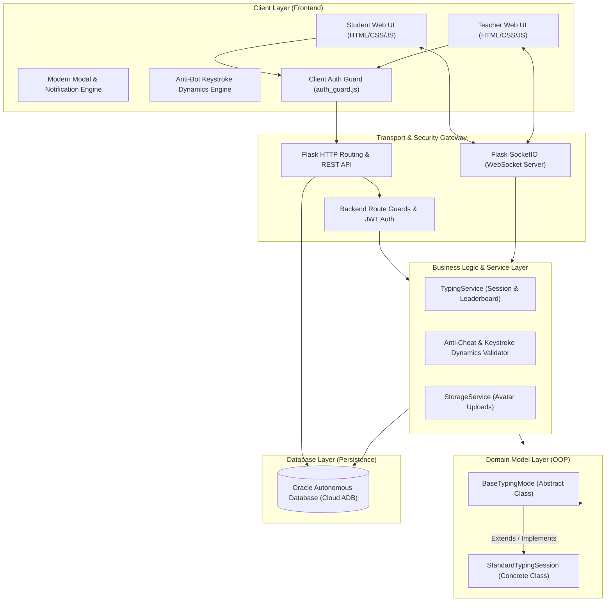
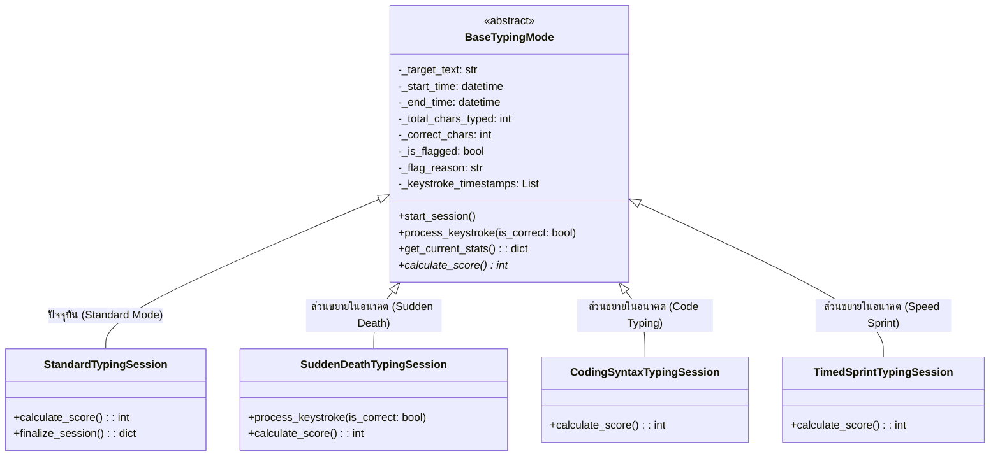
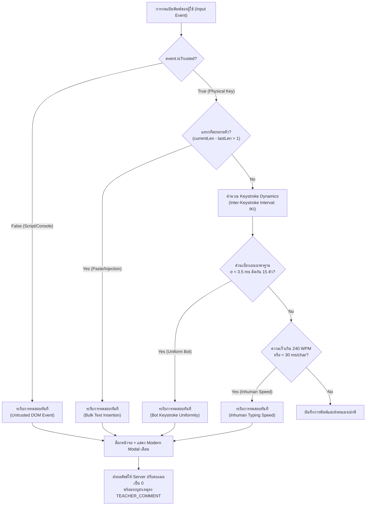

# รายงานโครงสร้างระบบและคู่มืออ้างอิงฟังก์ชันการทำงาน (System Architecture & Code Reference)

เอกสารฉบับนี้จัดทำขึ้นเพื่ออธิบายสถาปัตยกรรมซอฟต์แวร์ โครงสร้างไดเรกทอรี และการทำงานของทุกไฟล์และทุกฟังก์ชันในโครงการ **TypeClass (ระบบห้องเรียนฝึกพิมพ์ดีดออนไลน์)** อย่างละเอียด ครอบคลุมทั้งฝั่ง Frontend, Backend API, WebSocket Real-time, ระบบฐานข้อมูล Oracle Database, ระบบความปลอดภัย (Security & Route Guards), และระบบป้องกันการโกง/ตรวจจับบอท (Anti-Bot & Keystroke Dynamics)

---

## สารบัญ (Table of Contents)
1. [ภาพรวมสถาปัตยกรรมระบบ (System Architecture)](#1-ภาพรวมสถาปัตยกรรมระบบ-system-architecture)
2. [โครงสร้างไดเรกทอรีของโปรเจกต์ (Directory Structure)](#2-โครงสร้างไดเรกทอรีของโปรเจกต์-directory-structure)
3. [ไฟล์เริ่มต้นและตั้งค่าระบบ (Application Startup & Configuration)](#3-ไฟล์เริ่มต้นและตั้งค่าระบบ-application-startup--configuration)
4. [ชั้นฐานข้อมูลและการเชื่อมต่อ (Database Layer)](#4-ชั้นฐานข้อมูลและการเชื่อมต่อ-database-layer)
5. [ชั้นโครงสร้างข้อมูลและหลักการ OOP / SOLID (Domain Models & SOLID Principles)](#5-ชั้นโครงสร้างข้อมูลและหลักการ-oop--solid-domain-models--solid-principles)
   - 5.1 [รายละเอียดคลาสและเมธอดใน typing_session.py](#51-รายละเอียดคลาสและเมธอดใน-typing_sessionpy)
   - 5.2 [การประยุกต์ใช้หลักการ Open/Closed Principle (OCP) เชิงลึก](#52-การประยุกต์ใช้หลักการ-openclosed-principle-ocp-เชิงลึก)
   - 5.3 [การประยุกต์ใช้หลักการ SOLID ทั้ง 5 ประการในโปรเจกต์](#53-การประยุกต์ใช้หลักการ-solid-ทั้ง-5-ประการในโปรเจกต์)
6. [ชั้นตรรกะทางธุรกิจและการประมวลผล (Business Logic & Services Layer)](#6-ชั้นตรรกะทางธุรกิจและการประมวลผล-business-logic--services-layer)
7. [ชั้นการสื่อสารแบบ Real-time (WebSocket / Socket.IO Layer)](#7-ชั้นการสื่อสารแบบ-real-time-websocket--socketio-layer)
8. [ชั้นตัวกลางและระบบรักษาความปลอดภัย (Security & Route Guards)](#8-ชั้นตัวกลางและระบบรักษาความปลอดภัย-security--route-guards)
9. [ชั้นควบคุมเส้นทางเว็บและ API (Routing & HTTP Controllers)](#9-ชั้นควบคุมเส้นทางเว็บและ-api-routing--http-controllers)
   - 9.1 [ระบบยืนยันตัวตน (Authentication Routes)](#91-ระบบยืนยันตัวตน-authentication-routes)
   - 9.2 [ระบบฝั่งนักเรียน (Student Routes & API)](#92-ระบบฝั่งนักเรียน-student-routes--api)
   - 9.3 [ระบบฝั่งอาจารย์ (Teacher Routes & API)](#93-ระบบฝั่งอาจารย์-teacher-routes--api)
10. [ชั้นส่วนต่อประสานผู้ใช้และสคริปต์หน้าเว็บ (Frontend Templates & Scripts)](#10-ชั้นส่วนต่อประสานผู้ใช้และสคริปต์หน้าเว็บ-frontend-templates--scripts)
11. [ระบบความปลอดภัยและการตรวจจับบอท (Anti-Bot & Anti-Cheat Architecture)](#11-ระบบความปลอดภัยและการตรวจจับบอท-anti-bot--anti-cheat-architecture)
12. [ตารางแสดงความเชื่อมโยงของระบบ (Traceability & Data Flow Matrix)](#12-ตารางแสดงความเชื่อมโยงของระบบ-traceability--data-flow-matrix)

---

## 1. ภาพรวมสถาปัตยกรรมระบบ (System Architecture)

ระบบ TypeClass ได้รับการออกแบบตามแนวคิด **Layered Architecture (สถาปัตยกรรมแบบแบ่งชั้น)** และ **MVC (Model-View-Controller)** เพื่อให้โค้ดแยกส่วนความรับผิดชอบอย่างชัดเจน (Separation of Concerns) พร้อมประยุกต์ใช้หลักการ **OOP (Object-Oriented Programming)** และ **SOLID Principles**



---

## 2. โครงสร้างไดเรกทอรีของโปรเจกต์ (Directory Structure)

```text
OOP-SDD2-type/
├── run.py                          # จุดเริ่มต้นหลักสำหรับรันเซิร์ฟเวอร์ (Entry point)
├── app.py                          # สคริปต์รันเซิร์ฟเวอร์สำรอง
├── requirements.txt                # รายการไลบรารีและแพ็กเกจ Python ทั้งหมด
├── .env                            # ตัวแปรสภาพแวดล้อม (DB credentials, Secret Keys)
├── docs/                           # เอกสารประกอบโครงการ
│   ├── PROJECT_STRUCTURE_AND_FUNCTION_REFERENCE.md # เอกสารฉบับนี้
│   ├── oracle_database_erd.md      # แผนภาพ ER Diagram และ Data Dictionary
│   ├── websocket_api_spec.md       # สเปกระบบ Real-time Socket.IO
│   ├── checklest.md                # เช็กลิสต์การตรวจงานของรายวิชา
│   └── SETUP_GUIDE.md              # คู่มือติดตั้งและทดสอบระบบ
└── app/                            # โค้ดหลักของแอปพลิเคชัน
    ├── __init__.py                 # Application Factory (create_app)
    ├── config.py                   # คลาสตั้งค่า Configuration (DB, JWT, Secret)
    ├── database.py                 # ฟังก์ชันเชื่อมต่อ Oracle Database
    ├── models/                     # โมเดลเชิงวัตถุ (OOP Classes)
    │   ├── __init__.py
    │   ├── domain.py               # Data Classes & Domain Entities
    │   └── typing_session.py       # คลาสหลักระบบฝึกพิมพ์ (BaseTypingMode, StandardTypingSession)
    ├── services/                   # ตรรกะทางธุรกิจ (Business Logic Services)
    │   ├── __init__.py
    │   ├── typing_service.py       # จัดการเซสชันพิมพ์, Leaderboard, และ Anti-Cheat
    │   └── storage_service.py      # อัปโหลดและจัดการไฟล์รูปภาพโปรไฟล์
    ├── sockets/                    # การสื่อสารสองทิศทางแบบ Real-time (WebSockets)
    │   ├── __init__.py
    │   └── events.py               # ตัวจัดการ Event ของ Socket.IO ทั้งหมด
    ├── routes/                     # จุดควบคุมเส้นทาง HTTP (Controllers / Endpoints)
    │   ├── __init__.py
    │   ├── route_guards.py         # ตัวป้องกันเส้นทาง (Decorators: require_role, view_require_auth)
    │   ├── auth_routes.py          # เข้าสู่ระบบ, สมัครสมาชิก, Google OAuth, JWT
    │   ├── student_routes.py       # หน้าเว็บและ API ฝั่งนักเรียน
    │   └── teacher_routes.py       # หน้าเว็บและ API ฝั่งอาจารย์
    ├── static/                     # ไฟล์สถิต (Static Assets)
    │   ├── css/
    │   │   ├── style.css           # สไตล์หลักของระบบ
    │   │   └── modern_modal.css    # สไตล์กล่องข้อความแจ้งเตือน Modern Modal
    │   ├── js/
    │   │   ├── auth_guard.js       # ระบบตรวจสอบสิทธิ์ฝั่ง Frontend ก่อนเรนเดอร์หน้าเว็บ
    │   │   ├── modern_modal.js     # ตัวควบคุม Modern Modal (แทน alert, confirm, prompt)
    │   │   └── teacher_common.js   # โมดูลฟังก์ชันช่วยเหลือฝั่งอาจารย์ (TC Helper)
    │   └── uploads/                # ไดเรกทอรีจัดเก็บไฟล์รูปโปรไฟล์
    │       └── avatars/
    ├── templates/                  # หน้าเว็บ Jinja2 Templates
    │   ├── student/                # แม่แบบหน้าจอฝั่งนักเรียน
    │   │   ├── login.html          # หน้าเข้าสู่ระบบ (ทั้งครูและนักเรียน)
    │   │   ├── register.html       # หน้าลงทะเบียนบัญชีใหม่
    │   │   ├── classroom.html      # หน้ารายการห้องเรียนของนักเรียน
    │   │   ├── typing.html         # หน้าห้องฝึกพิมพ์และทำข้อสอบ (Anti-Bot Enabled)
    │   │   ├── typing-result.html  # หน้าแสดงผลลัพธ์คะแนนการพิมพ์
    │   │   ├── typing_history.html # หน้าประวัติการพิมพ์ของนักเรียน
    │   │   ├── profile.html        # หน้าจัดการโปรไฟล์นักเรียน
    │   │   ├── join.html           # หน้าค้นหาและขอเข้าห้องเรียน
    │   │   └── progress.html       # หน้าสรุปพัฒนาการความเร็ว
    │   └── teacher/                # แม่แบบหน้าจอฝั่งอาจารย์
    │       ├── Dashboard.html      # หน้าแดชบอร์ดภาพรวมและสรุปสถิติ
    │       ├── Manage-Classroom.html # หน้าควบคุมและเปิด/ปิดห้องสอบ Real-time
    │       ├── create-room.html    # หน้าสร้างห้องเรียนใหม่
    │       ├── students.html       # หน้าจัดการนักศึกษาแบบเจาะลึกรายห้อง (Drill-down)
    │       ├── history.html        # หน้ารายงานผลคะแนนและตรวจจับบอท
    │       ├── profile.html        # หน้าจัดการโปรไฟล์อาจารย์
    │       └── menu.html           # แม่แบบเมนูทางลัด
    └── utils/                      # เครื่องมือช่วยเหลือและค่าคงที่
        ├── __init__.py
        ├── constants.py            # ค่าคงที่ คลังคำศัพท์ และขีดจำกัดความเร็ว
        └── auth_utils.py           # เครื่องมือเข้ารหัสและถอดรหัสรหัสผ่าน
```

---

## 3. ไฟล์เริ่มต้นและตั้งค่าระบบ (Application Startup & Configuration)

### 3.1 `run.py` & `app.py`
* **หน้าที่หลัก:** จุดเริ่มต้นการทำงาน (Entry Point) สำหรับเปิดเซิร์ฟเวอร์ Flask + SocketIO
* **ฟังก์ชันและตรรกะสำคัญ:**
  * `create_app()`: เรียกใช้ Application Factory เพื่อสร้าง Flask instance
  * **ระบบค้นหาพอร์ตอัตโนมัติ (macOS Port 5000 Collision Safe):** ตรวจสอบพอร์ต 5000 ว่าถูกระบบ macOS AirPlay Receiver ยึดใช้งานอยู่หรือไม่ หากพอร์ต 5000 ไม่ว่าง ระบบจะสลับไปรันที่พอร์ต `5001` (หรือพอร์ตที่ระบุใน Environment Variable `PORT`) โดยอัตโนมัติ
  * `socketio.run(app, host='0.0.0.0', port=port, debug=True, allow_unsafe_werkzeug=True)`: รันเว็บเซิร์ฟเวอร์แบบรองรับ WebSocket ให้เข้าถึงได้ทั้งจาก `localhost`, `127.0.0.1` และ IP ภายในเครือข่าย

### 3.2 `app/config.py`
* **หน้าที่หลัก:** โหลดค่า Configuration จากไฟล์ `.env` เข้าสู่ Python Application
* **ฟังก์ชันและตรรกะสำคัญ:**
  * `load_dotenv()`: ดึงค่าตัวแปรสภาพแวดล้อม
  * ตัวแปรความปลอดภัย: `SECRET_KEY`, `JWT_SECRET_KEY`, `JWT_ACCESS_TOKEN_EXPIRES` (ตั้งค่าอายุของ Token)
  * ตัวแปรฐานข้อมูล Oracle: `ORACLE_USER`, `ORACLE_PASSWORD`, `ORACLE_DSN`, `ORACLE_CONFIG_DIR`, `ORACLE_WALLET_LOCATION`
  * ตัวแปร OAuth: `GOOGLE_CLIENT_ID`, `GOOGLE_CLIENT_SECRET`

### 3.3 `app/__init__.py`
* **หน้าที่หลัก:** Application Factory ตามรูปแบบสถาปัตยกรรม Flask มาตรฐาน
* **ฟังก์ชันและตรรกะสำคัญ:**
  * `create_app(config_class=Config)`:
    1. สร้าง Flask app instance และโหลด Config
    2. ติดตั้งส่วนขยายความปลอดภัย `CORS(app)` และ `JWTManager(app)`
    3. ผูก `SocketIO(app, cors_allowed_origins="*", async_mode="eventlet" / "threading")`
    4. ลงทะเบียน WebSockets ผ่าน `register_socket_events(socketio)`
    5. ลงทะเบียน Blueprints:
       - `auth_bp` (`/auth`) สำหรับการล็อกอิน/สมัครสมาชิก
       - `student_bp` (`/` และ `/api/student`) สำหรับมุมมองและ API นักเรียน
       - `teacher_bp` (`/teacher` และ `/api/teacher`) สำหรับมุมมองและ API อาจารย์
    6. ตั้งค่าโฟลเดอร์สำหรับจัดเก็บไฟล์อัปโหลดรูปโปรไฟล์ (`app/static/uploads/avatars`)

---

## 4. ชั้นฐานข้อมูลและการเชื่อมต่อ (Database Layer)

### `app/database.py`
* **หน้าที่หลัก:** จัดการการเชื่อมต่อไปยังฐานข้อมูล **Oracle Cloud Autonomous Database (ADB)**
* **ฟังก์ชันสำคัญ:**
  * `get_db_connection()`:
    * อ่านข้อมูลการเชื่อมต่อจาก `app.config`
    * เรียกใช้ `oracledb.connect(user=..., password=..., dsn=..., config_dir=..., wallet_location=..., wallet_password=...)`
    * รองรับทั้งโหมด Oracle Thick Driver (ใช้ Wallet Credentials) และ Thin Driver
    * ส่งคืนอ็อบเจกต์ Connection หรือส่งคืน `None` พร้อมบันทึกข้อผิดพลาดใน Log หากเชื่อมต่อไม่สำเร็จ เพื่อไม่ให้เซิร์ฟเวอร์หยุดทำงาน

---

## 5. ชั้นโครงสร้างข้อมูลและหลักการ OOP / SOLID (Domain Models & SOLID Principles)

ระบบ TypeClass ถูกออกแบบโดยยึดหลัก **Object-Oriented Programming (OOP)** ครบทั้ง 4 เสาหลัก (Abstraction, Encapsulation, Inheritance, Polymorphism) และปฏิบัติตาม **SOLID Principles** อย่างเคร่งครัด โดยเฉพาะหลักการ **Open/Closed Principle (OCP)**

---

### 5.1 รายละเอียดคลาสและเมธอดใน `app/models/typing_session.py`

#### คลาส `BaseTypingMode(ABC)` (Abstract Base Class)
* เป็นคลาสแม่นามธรรม ไม่สามารถสร้างอ็อบเจกต์ (Instantiate) โดยตรงได้ กำหนดสัญญาร่วม (Contract) และโครงสร้างมาตรฐานของทุกโหมดการพิมพ์
* **การห่อหุ้มข้อมูล (Encapsulation):**
  * `_target_text`: ข้อความเป้าหมายที่ต้องพิมพ์
  * `_start_time`, `_end_time`: เวลาเริ่มต้นและสิ้นสุดของเซสชัน
  * `_total_chars_typed`: จำนวนตัวอักษรทั้งหมดที่กด
  * `_correct_chars`: จำนวนตัวอักษรที่พิมพ์ถูกต้อง
  * `_is_completed`: สถานะว่าทำแบบทดสอบจบแล้วหรือยัง
  * `_is_flagged`: สถานะตรวจพบพฤติกรรมบอทหรือความผิดปกติ
  * `_flag_reason`: ข้อความระบุสาเหตุที่ถูกระบบตรวจพบ
  * `_keystroke_timestamps`: รายการบันทึก Timestamp ของการเคาะแป้นแต่ละครั้ง
* **เมธอดหลัก:**
  * `start_session()`: เริ่มจับเวลาเมื่อมีการเคาะแป้นตัวแรก
  * `process_keystroke(is_correct: bool)`: บันทึก Timestamp, เพิ่มจำนวนตัวอักษร และประมวลผล **Keystroke Dynamics (IKI Analysis)** แบบ Real-time:
    - คำนวณความต่างเวลา $\Delta t$ ระหว่างตัวอักษร
    - หาค่าเฉลี่ย ($\mu$) และส่วนเบี่ยงเบนมาตรฐาน ($\sigma$)
    - หาก $\sigma < 0.004\text{ s}$ (4 ms) สม่ำเสมอผิดธรรมชาติ จะตั้งสถานะ `_is_flagged = True`
    - หาก $\mu < 0.030\text{ s}$ (เคาะเร็วกว่า 30 ms/char หรือ > 400 WPM) จะตั้งสถานะ `_is_flagged = True`
  * `get_current_stats() -> dict`: คำนวณ Gross WPM, ความแม่นยำ Accuracy, เวลาที่ใช้ และดักจับความเร็วเกิน 240 WPM
  * `@abstractmethod def calculate_score() -> int`: **Abstract Method** บังคับให้คลาสลูกต้องกำหนดสูตรการคิดคะแนนตามเงื่อนไขของโหมดนั้นๆ (Polymorphism)

#### คลาส `StandardTypingSession(BaseTypingMode)`
* คลาสลูกที่สืบทอด (Inheritance) มาจาก `BaseTypingMode` เป็น Concrete Implementation สำหรับโหมดสอบมาตรฐาน
* **เมธอดสำคัญ:**
  * `calculate_score() -> int`: คำนวณคะแนนสุทธิ `WPM * (Accuracy / 100) * 10` โดยหากถูก Flagged ว่าใช้บอท (`_is_flagged == True`) จะปรับคะแนนเป็น **0 ทันที**
  * `finalize_session() -> Optional[dict]`: บันทึกเวลาสิ้นสุดและสรุปผลคะแนนรอบสุดท้าย

---

### 5.2 การประยุกต์ใช้หลักการ Open/Closed Principle (OCP) เชิงลึก

> **คำนิยาม (Bertrand Meyer & Robert C. Martin):**  
> *"Software entities (classes, modules, functions, etc.) should be open for extension, but closed for modification."*  
> (ซอฟต์แวร์ที่ดีควรเปิดกว้างต่อการต่อเติมขยายฟังก์ชันการทำงานใหม่ๆ แต่ต้องปิดกั้นไม่ให้กลับไปแก้ไขโค้ดเดิมที่ทำงานถูกต้องอยู่แล้ว)

#### 1. ความเป็น "Closed for Modification" ในระบบ TypeClass:
* คลาสแม่ `BaseTypingMode` ใน [typing_session.py](file:///Users/povofwinter/Desktop/U/OOP-SDD2-type/app/models/typing_session.py) รวบรวมตรรกะหัวใจสำคัญ ได้แก่:
  - การจับเวลาและสถานะเซสชัน (`start_session`, `_start_time`, `_end_time`)
  - การนับตัวอักษรและการประมวลผล Keystroke (`_total_chars_typed`, `_correct_chars`)
  - ระบบตรวจจับบอทและการโกงด้วย Keystroke Dynamics Analysis
  - การคำนวณสถิติพื้นฐาน WPM และ Accuracy
* โค้ดส่วนนี้ **"ปิดกั้นต่อการแก้ไข" (Closed for Modification)** เพราะมีความเสถียร มีการทดสอบความถูกต้องอย่างสมบูรณ์แล้ว หากในอนาคตต้องการเพิ่มโหมดการแข่งขันใหม่ๆ ทีมพัฒนาไม่จำเป็นต้องกลับมาแก้ไขโค้ดใน `BaseTypingMode` แม้แต่บรรทัดเดียว จึงขจัดความเสี่ยงต่อการเกิดข้อผิดพลาดกับโหมดเดิม (Zero Regression Risk)

#### 2. ความเป็น "Open for Extension" ผ่าน Abstract Method & Polymorphism:
* `BaseTypingMode` กำหนดจุดเชื่อมต่อผ่าน Abstract Method:
  ```python
  @abstractmethod
  def calculate_score(self) -> int:
      """คลาสลูกทุกคลาสต้องกำหนดสูตรคิดคะแนนและเงื่อนไขเฉพาะของตนเอง"""
      pass
  ```
* เมื่อต้องการสร้างโหมดการพิมพ์ใหม่ สามารถสืบทอด (Inherit) และเขียนคลาสใหม่เพิ่มขึ้นมาได้ทันที:



#### 3. ตัวอย่างโค้ดสาธิตการขยายโหมดใหม่โดยไม่แก้คลาสแม่ (Code Extension Example):

##### ตัวอย่างที่ 1: โหมด Sudden Death (พิมพ์ผิด 1 ตัวปรับตกทันที)
```python
class SuddenDeathTypingSession(BaseTypingMode):
    """โหมดสุดโหด: หากพิมพ์ผิดแม้แต่ตัวเดียว การทดสอบจะสิ้นสุดลงทันที"""
    def process_keystroke(self, is_correct: bool):
        super().process_keystroke(is_correct)
        if not is_correct:
            self._is_completed = True
            self._is_flagged = True
            self._flag_reason = "Game Over: พิมพ์ผิดในโหมด Sudden Death"

    def calculate_score(self) -> int:
        if self._is_flagged:
            return 0
        stats = self.get_current_stats()
        # โบนัสพิเศษสำหรับผู้ที่พิมพ์ได้แม่นยำ 100% ตลอดทั้งข้อสอบ
        return round(stats["wpm"] * 20)
```

##### ตัวอย่างที่ 2: โหมดฝึกพิมพ์โค้ดโปรแกรมมิ่ง (Coding Syntax Mode)
```python
class CodingSyntaxTypingSession(BaseTypingMode):
    """โหมดพิมพ์โค้ด: ให้คะแนนพิเศษแก่อักขระสัญลักษณ์เฉพาะทาง เช่น {}, (), [], ;, ->"""
    def calculate_score(self) -> int:
        if self._is_flagged:
            return 0
        stats = self.get_current_stats()
        # ถ่วงน้ำหนักคะแนน WPM และความแม่นยำ x1.5 เท่า
        return round(stats["wpm"] * (stats["accuracy"] / 100.0) * 15)
```

> **สรุปจุดเด่นของ OCP ในการตรวจงาน:**  
> อาจารย์สามารถเห็นได้ชัดเจนว่าคลาส `BaseTypingMode` ถูกออกแบบให้เป็นแม่แบบที่มั่นคง และพร้อมรองรับการขยายโหมดการพิมพ์ใหม่ๆ ได้ไม่จำกัดตามหลัก Open/Closed Principle

---

### 5.3 การประยุกต์ใช้หลักการ SOLID ทั้ง 5 ประการในโปรเจกต์

| ตัวอักษร | หลักการ (Principle) | การประยุกต์ใช้จริงในโครงการ TypeClass |
|:---:|---|---|
| **S** | **Single Responsibility Principle (SRP)** | แต่ละโมดูลและคลาสมีความรับผิดชอบเดียว:<br>• `typing_session.py` ดูแลเฉพาะเซสชันพิมพ์และอัลกอริทึมคะแนน<br>• `typing_service.py` ดูแลเฉพาะ Business Logic และ Leaderboard<br>• `events.py` ดูแลเฉพาะการรับ-ส่งข้อมูลทาง WebSocket<br>• `database.py` ดูแลเฉพาะ Connection ฐานข้อมูล Oracle |
| **O** | **Open/Closed Principle (OCP)** | สถาปัตยกรรม `BaseTypingMode` ที่ปิดกั้นการแก้ไขตรรกะภายใน แต่เปิดให้ขยายโหมดใหม่ผ่านการสืบทอดและการ Implement เมธอด `calculate_score()` |
| **L** | **Liskov Substitution Principle (LSP)** | ทุกคลาสลูก (เช่น `StandardTypingSession`) สามารถนำไปส่งให้ `TypingService` ใช้งานแทนที่คลาสแม่ `BaseTypingMode` ได้อย่างสมบูรณ์แบบ โดยระบบยังคงรันได้ราบรื่นและคำนวณผลลัพธ์ได้อย่างถูกต้องตามสัญญา |
| **I** | **Interface Segregation Principle (ISP)** | การออกแบบ Abstract Base Class ที่กระชับ มีเฉพาะเมธอดและพร็อพเพอร์ตี้ที่จำเป็นจริงๆ (`start_session`, `process_keystroke`, `calculate_score`, `get_current_stats`) ไม่บังคับให้คลาสลูกต้องพกพาฟังก์ชันที่ตนเองไม่ได้ใช้ |
| **D** | **Dependency Inversion Principle (DIP)** | ชั้นบริการระดับสูง (`TypingService`) พึ่งพา Abstraction (`BaseTypingMode`) มากกว่าการผูกมัดแน่นกับ Concrete Class และระบบเชื่อมต่อฐานข้อมูลใน `get_db_connection()` พึ่งพาค่าตัวแปรสภาพแวดล้อมและการตั้งค่า Config ทำให้สามารถสลับโหมดทดสอบหรือเปลี่ยนฐานข้อมูลได้โดยไม่ต้องรื้อโค้ด |

---

---

## 6. ชั้นตรรกะทางธุรกิจและการประมวลผล (Business Logic & Services Layer)

### 6.1 `app/services/typing_service.py`
* **หน้าที่หลัก:** ให้บริการทางธุรกิจ (Service Layer) ควบคุมเซสชันการพิมพ์สดของผู้ใช้ทุกคน ตารางคะแนนสด (Leaderboard) และการบันทึกผลลง Oracle DB
* **คลาส `TypingService` และเมธอดสำคัญ:**
  * `register_user_session(sid, user_id, username)`: บันทึกข้อมูลผู้ใช้เมื่อเชื่อมต่อผ่าน WebSocket
  * `get_user_session(sid)`: ดึงข้อมูลเซสชันจาก Socket ID
  * `join_room(sid, room_code)`: ผูก Socket ID เข้ากับห้องเรียน และสร้างโครงสร้าง Leaderboard ของห้อง
  * `start_typing_session(sid)`: สุ่มคำศัพท์จาก `GENERAL_WORDS` และ `CODING_WORDS` จำนวน 500 คำ จากนั้นสร้างอ็อบเจกต์ `StandardTypingSession`
  * `process_keystroke(sid, is_correct)`: ส่งต่อไปยัง `typing_session.process_keystroke()` และอัปเดต Leaderboard สดของห้องเรียน ส่งคืนสถิติล่าสุดและรายชื่อผู้เข้าสอบที่เรียงตาม WPM
  * `submit_score(sid, data)`:
    - ตรวจสอบความถูกต้องและดักจับ Anti-Cheat (WPM > 240, เวลา < 5 วิ, หรือสถานะ Flagged)
    - หากตรวจพบบอท: กำหนดคะแนนเป็น 0 และระบุ `TEACHER_COMMENT = "[ANTI_BOT_FLAGGED] ..."`
    - บันทึกลงตาราง `U.SUBMISSION_RESULTS` ใน Oracle Cloud ADB ด้วยคำสั่ง Parameterized SQL
  * `remove_session(sid)`: ล้างข้อมูลเซสชันและลบออกจาก Leaderboard เมื่อผู้ใช้ตัดการเชื่อมต่อ

### 6.2 `app/services/storage_service.py`
* **หน้าที่หลัก:** จัดการการตรวจสอบความถูกต้องและบันทึกไฟล์รูปภาพโปรไฟล์
* **ฟังก์ชันสำคัญ:**
  * `upload_profile_image(file_storage, user_id)`:
    - ตรวจสอบนามสกุลไฟล์ที่อนุญาต (`.png`, `.jpg`, `.jpeg`, `.webp`, `.gif`)
    - สร้างชื่อไฟล์ที่ไม่ซ้ำกันด้วย `uuid.uuid4()` และ `secure_filename`
    - บันทึกไฟล์ลงใน `app/static/uploads/avatars/`
    - ส่งคืน URL สัมพัทธ์สำหรับเก็บลงคอลัมน์ `PROFILE_IMAGE_URL` ในตาราง `U.USERS`

---

## 7. ชั้นการสื่อสารแบบ Real-time (WebSocket / Socket.IO Layer)

### `app/sockets/events.py`
* **หน้าที่หลัก:** จัดการ Event-driven Architecture ผ่าน WebSocket รองรับการแข่งขันพิมพ์สดและการแจ้งเตือนระหว่างอาจารย์กับนักศึกษา
* **ฟังก์ชันและ Event Handlers:**
  * `register_socket_events(socketio: SocketIO)`: ลงทะเบียนตัวรับ Event ทั้งหมด
  * **Event `@socketio.on('connect')`:** ตรวจสอบความถูกต้องของ JWT Token ที่ส่งมาใน `auth` handshake หากถูกต้องจะระบุตัวตนของผู้ใช้ หากไม่มีจะกำหนดเป็น Guest Session ชั่วคราว
  * **Event `@socketio.on('student_join')` / `@socketio.on('join_classroom')`:**
    - ดึงรหัสห้อง `room_code` แปลงเป็นตัวพิมพ์ใหญ่
    - **Room Status Guard:** ตรวจสอบว่าห้องเรียนถูกปิดอยู่หรือไม่ หากห้องปิดอยู่จะส่ง Event `room_closed` กลับไป และปฏิเสธไม่ให้เข้าห้อง
    - เรียก `join_room(room)` และแจ้งเตือนทุกคนในห้องว่ามีนักเรียนเข้าร่วม
    - กระจายตารางอันดับสด `room_leaderboard_update` ให้ทุกคนในห้องเห็น
  * **Event `@socketio.on('leave_classroom')` / `@socketio.on('leave_room')`:** ให้นักเรียนออกจากกลุ่มรับข้อความของห้องเรียน
  * **Event `@socketio.on('teacher_join_room')`:** ให้อาจารย์เข้าฟังสถิติของห้องเรียนได้โดยไม่ถูกนับชื่อลงใน Leaderboard ของนักเรียน
  * **Event `@socketio.on('start_typing')`:** เรียกใช้ `typing_service.start_typing_session()` แล้วส่งชุดคำศัพท์ `typing_started` กลับไปให้นักเรียน
  * **Event `@socketio.on('keystroke')`:** รับการเคาะแป้นแต่ละตัว คำนวณความเร็ว และส่งสถิติส่วนบุคคล `live_stats` กลับให้นักเรียน พร้อมกระจาย `room_leaderboard_update` ให้ทุกคนในห้องเรียนแบบเสี้ยววินาที
  * **Event `@socketio.on('submit_score')`:** บันทึกคะแนนผ่าน WebSocket ลง Oracle DB และส่งผลลัพธ์กลับ
  * **Event `@socketio.on('disconnect')`:** ล้างข้อมูลเซสชันผ่าน `typing_service.remove_session()`

---

## 8. ชั้นตัวกลางและระบบรักษาความปลอดภัย (Security & Route Guards)

### `app/routes/route_guards.py`
* **หน้าที่หลัก:** ระบบรักษาความปลอดภัยแบบสองชั้น (Dual-Layer Guards) ป้องกันการพิมพ์ URL ลัดเพื่อเข้าถึงหน้าเว็บหรือ API ที่ไม่มีสิทธิ์
* **Decorators สำคัญ:**
  * `@require_role(role_name)`: ใช้สำหรับ API Endpoints ตรวจสอบ JWT Claims และ Cookie ว่าผู้ใช้มีบทบาทตามที่กำหนด (`Student` หรือ `Teacher`) หรือไม่ หากไม่มีสิทธิ์จะส่งคืน HTTP 403 Forbidden
  * `@view_require_auth(allowed_roles=None)`: ใช้สำหรับหน้าเว็บ View (HTML) ตรวจสอบว่าผู้ใช้ล็อกอินหรือยัง และตรวจสอบบทบาท หากไม่ผ่านจะ Redirect ไปหน้าล็อกอินทันที
  * `@view_redirect_if_authenticated()`: ใช้สำหรับหน้า Login และ Register หากผู้ใช้ล็อกอินอยู่แล้วจะ Redirect ไปยังหน้า Dashboard ที่ถูกต้องตาม Role ของตนเองทันที

### `app/static/js/auth_guard.js`
* **หน้าที่หลัก:** Client-Side Route Guard ทำงานร่วมกับ CSS ป้องกันปัญหา **FOUC (Flash of Unauthenticated Content)**
* **ฟังก์ชันสำคัญ:**
  * ปิดการแสดงผลของหน้าเว็บทันที (`html { display: none !important; }`) จนกว่าจะตรวจสอบ Token สำเร็จ
  * `requireAuth(requiredRole)`: ตรวจสอบ `localStorage.getItem('token')` และ `user.role` หากไม่มีสิทธิ์จะ Redirect ไปยังหน้า Login ทันที
  * `redirectIfAuthenticated()`: หากมี Token อยู่แล้วในเบราว์เซอร์ จะพาเข้าสู่หน้า Dashboard ทันทีโดยไม่ต้องล็อกอินซ้ำ

---

## 9. ชั้นควบคุมเส้นทางเว็บและ API (Routing & HTTP Controllers)

### 9.1 ระบบยืนยันตัวตน (Authentication Routes)
**ไฟล์:** `app/routes/auth_routes.py` (Blueprint: `auth_bp`)

| เส้นทาง (Route) | เมธอด | ฟังก์ชัน | รายละเอียดการทำงาน |
|---|:---:|---|---|
| `/auth/register` | `POST` | `register_user()` | รับข้อมูล `username`, `email`, `password`, `full_name`, `role` แฮชรหัสผ่านด้วย `generate_password_hash` และบันทึกลงตาราง `U.USERS` และสร้างเรคอร์ดคู่ใน `U.STUDENTS` หรือ `U.TEACHERS` |
| `/auth/login` | `POST` | `login_user()` | ตรวจสอบชื่อผู้ใช้และรหัสผ่าน (`check_password_hash`) ออก Access Token (JWT) และเซ็ต Cookie `user_role`, `access_token` |
| `/auth/google` | `POST` | `google_login()` | ยืนยันตัวตนด้วย Google Access Token หรือ Email จาก Google OAuth เชื่อมโยงบัญชีเดิมหรือสร้างบัญชีใหม่อัตโนมัติ |
| `/auth/google/oauth` | `GET` | `google_oauth_redirect()` | นำทางผู้ใช้ไปยังหน้าลงชื่อเข้าใช้ของ Google Accounts |
| `/auth/logout` | `POST`, `GET` | `logout_user()` | ล้างคุกกี้ ยืนยันการออกจากระบบ |

---

### 9.2 ระบบฝั่งนักเรียน (Student Routes & API)
**ไฟล์:** `app/routes/student_routes.py` (Blueprint: `student_bp`)

| เส้นทาง (Route) | เมธอด | ฟังก์ชัน | รายละเอียดการทำงาน |
|---|:---:|---|---|
| `/` หรือ `/login` | `GET` | `login_page()` | แสดงหน้าเข้าสู่ระบบ (Student & Teacher) |
| `/register` | `GET` | `register_page()` | แสดงหน้าสมัครสมาชิกใหม่ |
| `/classroom` | `GET` | `classroom_page()` | แสดงหน้ารวมห้องเรียนของนักเรียน |
| `/typing` | `GET` | `typing_page()` | แสดงหน้าพิมพ์ข้อความและทดสอบในห้องเรียน |
| `/result` | `GET` | `result_page()` | แสดงหน้าผลลัพธ์คะแนนการพิมพ์ |
| `/history` | `GET` | `history_page()` | แสดงหน้าประวัติคะแนนของนักเรียน |
| `/profile` | `GET` | `profile_page()` | แสดงหน้าจัดการโปรไฟล์นักเรียน |
| `/api/student/classrooms` | `GET` | `get_student_classrooms()` | ดึงรายการห้องเรียนที่นักเรียนเป็นสมาชิก พร้อมสถานะห้อง (Open/Closed), WPM สูงสุด, และเวลาสอบ |
| `/api/student/classrooms/join` | `POST` | `join_student_classroom()` | **ดักจับห้องปิด:** ตรวจสอบรหัสห้อง หากห้องปิดอยู่จะส่ง 403 Forbidden ปฏิเสธไม่ให้เข้า หากเปิดอยู่จะบันทึกลง `U.CLASSROOM_MEMBERS` |
| `/api/student/classrooms/leave`| `POST` | `leave_student_classroom()`| นำนักเรียนออกจากห้องเรียนที่เลือก |
| `/api/student/submissions` | `POST` | `submit_typing_result()` | **Anti-Bot Validation:** ตรวจสอบผลคะแนน WPM, ความแม่นยำ และเวลาสอบ หากตรวจพบบอทจะบันทึก `GRADE_OR_SCORE = 0` พร้อมระบุสาเหตุลง `TEACHER_COMMENT` |
| `/api/student/profile` | `GET`, `PUT`, `DELETE` | `student_profile_api()` | จัดการข้อมูลส่วนตัว อัปเดตชื่อผู้ใช้ และลบบัญชี |
| `/api/student/profile/avatar` | `POST` | `upload_avatar()` | อัปโหลดรูปภาพโปรไฟล์ผ่าน `storage_service` |

---

### 9.3 ระบบฝั่งอาจารย์ (Teacher Routes & API)
**ไฟล์:** `app/routes/teacher_routes.py` (Blueprint: `teacher_bp`)

| เส้นทาง (Route) | เมธอด | ฟังก์ชัน | รายละเอียดการทำงาน |
|---|:---:|---|---|
| `/teacher/dashboard` | `GET` | `teacher_dashboard_view()` | หน้าแดชบอร์ดสรุปสถิตินักศึกษา ห้องเรียน และคะแนนเฉลี่ย |
| `/teacher/rooms/<room_code>` | `GET` | `teacher_manage_classroom_view()` | หน้าควบคุมห้องเรียนแบบ Real-time สำหรับเปิด/ปิดห้อง และดูผู้เข้าสอบสด |
| `/teacher/students` | `GET` | `teacher_students_view()` | **Classroom Drill-down:** หน้ารายชื่อนักศึกษา แบ่งกลุ่มตามห้องเรียน |
| `/teacher/history` | `GET` | `teacher_history_view()` | หน้ารายงานผลคะแนนการสอบ แยกตามห้องเรียน และแสดงสถานะบอท |
| `/teacher/profile` | `GET` | `teacher_profile_view()` | หน้าจัดการโปรไฟล์อาจารย์ |
| `/teacher/rooms` | `POST` | `create_room()` | สร้างห้องเรียนใหม่ บันทึกลงตาราง `U.CLASSROOMS` |
| `/teacher/rooms/<room_code>/status` | `PATCH` | `update_room_status()` | **Real-time Room Kickout:** เปลี่ยนสถานะห้อง (`open`/`closed`) พร้อมยิง WebSocket Event `room_closed` ไปดีดนักเรียนที่กำลังพิมพ์อยู่ออกทันที |
| `/teacher/api/rooms/<room_code>` | `DELETE` | `delete_room()` | ลบห้องเรียนและผลคะแนนที่เกี่ยวข้อง พร้อมแจ้งดีดนักเรียนออกจากห้อง |
| `/teacher/api/students` | `GET` | `api_teacher_students()` | ดึงข้อมูลสรุปการ์ดห้องเรียน และรายชื่อนักศึกษาในห้องที่เลือก |
| `/teacher/api/history` | `GET` | `api_teacher_history()` | ดึงประวัติการสอบทั้งหมด ดึงค่า `TEACHER_COMMENT` เพื่อตรวจจับและติดแท็กบอท |

---

## 10. ชั้นส่วนต่อประสานผู้ใช้และสคริปต์หน้าเว็บ (Frontend Templates & Scripts)

### 10.1 โมดูลระบบแจ้งเตือน Modern Modal (`app/static/js/modern_modal.js`)
* ออกแบบเพื่อแทนที่คำสั่งดั้งเดิมของเบราว์เซอร์ (`window.alert`, `window.confirm`, `window.prompt`) ที่มีหน้าตาไม่ทันสมัย
* **ฟังก์ชันหลัก:**
  * `showModernPopup({ type, title, message, buttonText, onConfirm })`: แสดงหน้าต่างแจ้งเตือนแบบโมเดิร์น รองรับสถานะ `success`, `error`, `warning`, `info`
  * `showModernConfirm({ type, title, message, confirmText, cancelText, danger })`: แสดงกล่องยืนยันการทำรายการแบบ Async/Await
  * `showModernPrompt({ title, message, placeholder, defaultValue })`: แสดงกล่องรับข้อความจากผู้ใช้
  * `closeModernPopup(result)`: ปิดกล่องข้อความและส่งค่าผลลัพธ์กลับสู่ Promise

### 10.2 หน้าจอห้องฝึกพิมพ์และทำข้อสอบ (`app/templates/student/typing.html`)
* **หน้าที่:** หน้าจอหลักที่นักเรียนใช้ฝึกพิมพ์และสอบในห้องเรียน
* **กลไกและฟังก์ชันสำคัญ:**
  * `AntiBot.recordKeystroke(e, currentLen, prevLen)`: กลไกตรวจจับบอทฝั่ง Client
  * `handleRoomClosedNotification(data)`: **ดีดนักเรียนออกจากห้องสอบทันที** เมื่อได้รับ Event `room_closed` หรือ `room_status_changed` จากอาจารย์:
    1. หยุดตัวจับเวลา (`clearInterval`)
    2. ปิดการใช้งานช่องพิมพ์ (`typingInput.disabled = true`)
    3. ซ่อน UI ห้องสอบ ปรับสถานะเป็นโหมดฝึกซ้อม
    4. แสดง Modern Modal แจ้งเตือน: *"ห้องเรียนปิดแล้ว: อาจารย์ได้ปิดห้องทดสอบแล้ว"*
    5. พานักเรียนกลับสู่หน้ารวมห้องเรียน ([/classroom](file:///Users/povofwinter/Desktop/U/OOP-SDD2-type/app/templates/student/classroom.html)) อัตโนมัติ
  * `submitJoinRoom()`: เข้าร่วมห้องสอบ พร้อมดักจับข้อผิดพลาด 403 หากห้องนั้นปิดอยู่

### 10.3 หน้าจอจัดการนักศึกษาแบบเจาะลึก (`app/templates/teacher/students.html`)
* **หน้าที่:** แสดงรายชื่อนักศึกษาแยกตามห้องเรียนด้วยระบบ **2-Level Navigation (Classroom Cards Grid -> Detail Table)**
* เมื่อเปิดหน้าแรกจะเห็นการ์ดห้องเรียนพร้อมสรุปจำนวนนักศึกษาและสถานะ
* เมื่อคลิกการ์ดห้องเรียน จะเจาะลึก (Drill-down) เข้าไปดูตารางรายชื่อนักศึกษาเฉพาะห้องนั้น พร้อมปุ่มย้อนกลับและตัวค้นหาแบบ Real-time

### 10.4 หน้าจอรายงานคะแนนและตรวจพบบอท (`app/templates/teacher/history.html`)
* **หน้าที่:** แสดงผลคะแนนการพิมพ์ทั้งหมดของนักศึกษา
* มีการ์ดสรุปภาพรวมห้องเรียนแบบ Drill-down
* ในคอลัมน์ประเมินผล: หากระบบตรวจพบบอท จะแสดง Badge เตือนสีแดงเด่นชัดว่า **`⚠️ ตรวจพบบอท`** พร้อมแสดงเหตุผลที่ถูกตรวจพบเมื่อนำเมาส์ไปชี้ (Tooltip)

---

## 11. ระบบความปลอดภัยและการตรวจจับบอท (Anti-Bot & Anti-Cheat Architecture)

โครงการ TypeClass ได้รับการออกแบบระบบป้องกันบอทแบบหลายชั้น (Multi-layered Anti-Cheat) ครอบคลุมทั้งฝั่ง Client และ Server:



---

## 12. ตารางแสดงความเชื่อมโยงของระบบ (Traceability & Data Flow Matrix)

| ความต้องการเชิงฟังก์ชัน (Requirement) | องค์ประกอบในสถาปัตยกรรม (Design Element) | ไฟล์โค้ดหลักที่รับผิดชอบ | ฟังก์ชัน / ตัวจัดการที่เกี่ยวข้อง |
|---|---|---|---|
| **การยืนยันตัวตนสองบทบาท (Role-based Auth)** | Class-table Inheritance (`USERS` ↔ `STUDENTS`, `TEACHERS`) | `app/routes/auth_routes.py`<br>`app/routes/route_guards.py` | `login_user()`<br>`@require_role()`<br>`@view_require_auth()` |
| **การฝึกพิมพ์และประมวลผลคะแนน (OOP / SOLID)** | `BaseTypingMode` (Abstract)<br>`StandardTypingSession` (Concrete) | `app/models/typing_session.py`<br>`app/services/typing_service.py` | `process_keystroke()`<br>`calculate_score()`<br>`get_current_stats()` |
| **ตารางอันดับสดห้องเรียน (Real-time Leaderboard)** | WebSocket Room Broadcasting | `app/sockets/events.py`<br>`app/services/typing_service.py` | `handle_keystroke()`<br>`room_leaderboard_update` |
| **อาจารย์สั่งปิดห้องแล้วดีดนักเรียนออกทันที** | Real-time Lifecycle Event Emission | `app/routes/teacher_routes.py`<br>`app/templates/student/typing.html` | `update_room_status()`<br>`socketio.emit("room_closed")`<br>`handleRoomClosedNotification()` |
| **ระบบป้องกันการโกงและตรวจจับบอท (Anti-Bot)** | Keystroke Dynamics Analysis & IKI Uniformity | `app/templates/student/typing.html`<br>`app/models/typing_session.py`<br>`app/routes/student_routes.py` | `AntiBot.recordKeystroke()`<br>`submit_typing_result()` |
| **การจัดการห้องเรียนแบบเจาะลึก (Drill-down)** | 2-Level Grid-to-Table Navigation | `app/templates/teacher/students.html`<br>`app/routes/teacher_routes.py` | `selectRoom()`<br>`api_teacher_students()` |
| **รายงานคะแนนและแจ้งเตือนบอทของอาจารย์** | Data Table & Flagged Evaluation Tag | `app/templates/teacher/history.html`<br>`app/routes/teacher_routes.py` | `renderHistory()`<br>`api_teacher_history()` |
| **การบันทึกประวัติลงฐานข้อมูลคลาวด์** | Parameterized SQL on Oracle Cloud ADB | `app/database.py`<br>`app/routes/student_routes.py` | `get_db_connection()`<br>`submit_typing_result()` |

---
*เอกสารนี้จัดทำและปรับปรุงล่าสุด: พฤศจิกายน 2026 สำหรับโครงการ TypeClass (OOP & SDD 2)*

