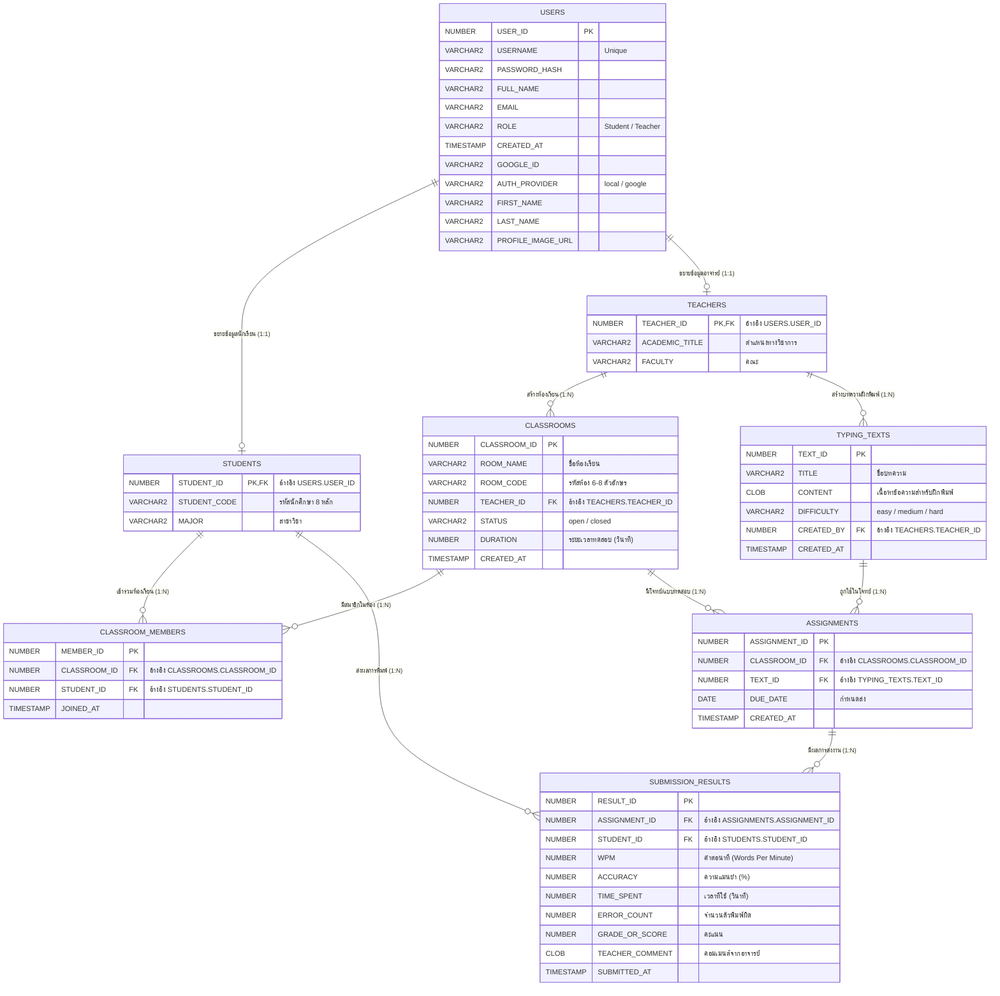

# แผนภาพ Entity-Relationship Diagram (ERD) - Oracle Database (Schema: U)

เอกสารนี้แสดงโครงสร้างฐานข้อมูล Oracle Autonomous Database ที่เชื่อมต่อกับระบบ **TypeClass (OOP-SDD2-type)** ดึงข้อมูลจริงจากระบบ Schema `U`

---

## 1. แผนภาพ ER Diagram (Mermaid)

---

## 2. พจนานุกรมข้อมูล (Data Dictionary)

### 2.1 ตาราง `USERS` (ตารางหลักของผู้ใช้งานทุกคน)
| ชื่อคอลัมน์ | ชนิดข้อมูล (Data Type) | Nullable | คีย์ | คำอธิบาย |
|---|---|:---:|:---:|---|
| `USER_ID` | `NUMBER` | No | **PK** | รหัสผู้ใช้งานหลัก (Auto Sequence) |
| `USERNAME` | `VARCHAR2(50)` | No | | ชื่อบัญชีผู้ใช้สำหรับล็อกอิน |
| `PASSWORD_HASH` | `VARCHAR2(255)` | No | | รหัสผ่านเข้ารหัสแบบ bcrypt / hash |
| `FULL_NAME` | `VARCHAR2(100)` | No | | ชื่อ-นามสกุลจริง |
| `EMAIL` | `VARCHAR2(100)` | No | | อีเมล |
| `ROLE` | `VARCHAR2(10)` | No | | บทบาทผู้ใช้ (`Student` หรือ `Teacher`) |
| `CREATED_AT` | `TIMESTAMP(6)` | Yes | | วันที่และเวลาที่สร้างบัญชี |
| `GOOGLE_ID` | `VARCHAR2(255)` | Yes | | ID เฉพาะจาก Google OAuth |
| `AUTH_PROVIDER` | `VARCHAR2(50)` | Yes | | ช่องทางเข้าสู่ระบบ (`local`, `google`) |
| `FIRST_NAME` | `VARCHAR2(100)` | Yes | | ชื่อจริง |
| `LAST_NAME` | `VARCHAR2(100)` | Yes | | นามสกุล |
| `PROFILE_IMAGE_URL` | `VARCHAR2(500)` | Yes | | URL รูปโปรไฟล์ (บน OCI Object Storage) |

---

### 2.2 ตาราง `STUDENTS` (ข้อมูลเฉพาะของนักเรียน - Table Inheritance 1:1)
| ชื่อคอลัมน์ | ชนิดข้อมูล | Nullable | คีย์ | คำอธิบาย |
|---|---|:---:|:---:|---|
| `STUDENT_ID` | `NUMBER` | No | **PK, FK** | อ้างอิง `USERS.USER_ID` |
| `STUDENT_CODE` | `VARCHAR2(20)` | No | | รหัสนักศึกษา (เช่น 8 หลัก) |
| `MAJOR` | `VARCHAR2(100)` | Yes | | สาขาวิชา / ภาควิชา |

---

### 2.3 ตาราง `TEACHERS` (ข้อมูลเฉพาะของอาจารย์ - Table Inheritance 1:1)
| ชื่อคอลัมน์ | ชนิดข้อมูล | Nullable | คีย์ | คำอธิบาย |
|---|---|:---:|:---:|---|
| `TEACHER_ID` | `NUMBER` | No | **PK, FK** | อ้างอิง `USERS.USER_ID` |
| `ACADEMIC_TITLE` | `VARCHAR2(50)` | Yes | | ตำแหน่งวิชาการ (ศ., รศ., ผศ., อ.) |
| `FACULTY` | `VARCHAR2(100)` | Yes | | คณะ |

---

### 2.4 ตาราง `CLASSROOMS` (ห้องเรียน)
| ชื่อคอลัมน์ | ชนิดข้อมูล | Nullable | คีย์ | คำอธิบาย |
|---|---|:---:|:---:|---|
| `CLASSROOM_ID` | `NUMBER` | No | **PK** | รหัสห้องเรียนภายในระบบ |
| `ROOM_NAME` | `VARCHAR2(100)` | No | | ชื่อห้องเรียน |
| `ROOM_CODE` | `VARCHAR2(10)` | No | | รหัสห้องสำหรับให้นักเรียนเข้าร่วม |
| `TEACHER_ID` | `NUMBER` | No | **FK** | อ้างอิงอาจารย์ผู้สร้างห้อง (`TEACHERS.TEACHER_ID`) |
| `STATUS` | `VARCHAR2(20)` | Yes | | สถานะห้อง (`open`, `closed`) |
| `DURATION` | `NUMBER` | Yes | | เวลาสอบเป็นวินาที |
| `CREATED_AT` | `TIMESTAMP(6)` | Yes | | เวลาที่เปิดห้อง |

---

### 2.5 ตาราง `CLASSROOM_MEMBERS` (การเข้าร่วมห้องเรียนของนักเรียน - Many to Many Junction)
| ชื่อคอลัมน์ | ชนิดข้อมูล | Nullable | คีย์ | คำอธิบาย |
|---|---|:---:|:---:|---|
| `MEMBER_ID` | `NUMBER` | No | **PK** | รหัสสมาชิกห้องเรียน |
| `CLASSROOM_ID` | `NUMBER` | No | **FK** | อ้างอิง `CLASSROOMS.CLASSROOM_ID` |
| `STUDENT_ID` | `NUMBER` | No | **FK** | อ้างอิง `STUDENTS.STUDENT_ID` |
| `JOINED_AT` | `TIMESTAMP(6)` | Yes | | วันที่และเวลาที่เข้าร่วมห้อง |

---

### 2.6 ตาราง `TYPING_TEXTS` (คลังบทความข้อความฝึกพิมพ์)
| ชื่อคอลัมน์ | ชนิดข้อมูล | Nullable | คีย์ | คำอธิบาย |
|---|---|:---:|:---:|---|
| `TEXT_ID` | `NUMBER` | No | **PK** | รหัสบทความ |
| `TITLE` | `VARCHAR2(150)` | No | | หัวข้อบทความ |
| `CONTENT` | `CLOB` | No | | เนื้อหาข้อความฝึกพิมพ์ขนาดใหญ่ |
| `DIFFICULTY` | `VARCHAR2(10)` | Yes | | ระดับความยาก (`easy`, `medium`, `hard`) |
| `CREATED_BY` | `NUMBER` | No | **FK** | อาจารย์ผู้เขียนบทความ (`TEACHERS.TEACHER_ID`) |
| `CREATED_AT` | `TIMESTAMP(6)` | Yes | | วันที่สร้างบทความ |

---

### 2.7 ตาราง `ASSIGNMENTS` (การมอบหมายแบบทดสอบในห้องเรียน)
| ชื่อคอลัมน์ | ชนิดข้อมูล | Nullable | คีย์ | คำอธิบาย |
|---|---|:---:|:---:|---|
| `ASSIGNMENT_ID` | `NUMBER` | No | **PK** | รหัสการมอบหมายงาน |
| `CLASSROOM_ID` | `NUMBER` | No | **FK** | ห้องเรียนที่มอบหมาย (`CLASSROOMS.CLASSROOM_ID`) |
| `TEXT_ID` | `NUMBER` | No | **FK** | บทความที่ใช้สอบ (`TYPING_TEXTS.TEXT_ID`) |
| `DUE_DATE` | `DATE` | Yes | | กำหนดส่งงาน |
| `CREATED_AT` | `TIMESTAMP(6)` | Yes | | วันที่มอบหมายงาน |

---

### 2.8 ตาราง `SUBMISSION_RESULTS` (ผลลัพธ์การฝึกพิมพ์และการสอบ)
| ชื่อคอลัมน์ | ชนิดข้อมูล | Nullable | คีย์ | คำอธิบาย |
|---|---|:---:|:---:|---|
| `RESULT_ID` | `NUMBER` | No | **PK** | รหัสผลการพิมพ์ |
| `ASSIGNMENT_ID` | `NUMBER` | No | **FK** | อ้างอิงโจทย์ (`ASSIGNMENTS.ASSIGNMENT_ID`) |
| `STUDENT_ID` | `NUMBER` | No | **FK** | อ้างอิงนักเรียนผู้ส่งผล (`STUDENTS.STUDENT_ID`) |
| `WPM` | `NUMBER(5,2)` | No | | ความเร็วพิมพ์ (คำต่อนาที) |
| `ACCURACY` | `NUMBER(5,2)` | No | | เปอร์เซ็นต์ความแม่นยำ (0 - 100%) |
| `TIME_SPENT` | `NUMBER` | No | | เวลาที่ใช้พิมพ์ทั้งหมด (วินาที) |
| `ERROR_COUNT` | `NUMBER` | Yes | | จำนวนคำ/ตัวอักษรที่พิมพ์ผิด |
| `GRADE_OR_SCORE` | `NUMBER(5,2)` | Yes | | คะแนนหรือเกรดที่ได้ |
| `TEACHER_COMMENT` | `CLOB` | Yes | | ความคิดเห็น/ข้อเสนอแนะจากอาจารย์ |
| `SUBMITTED_AT` | `TIMESTAMP(6)` | Yes | | วันที่และเวลาที่บันทึกผลการพิมพ์ |

---

## 3. ความสัมพันธ์ระหว่างเอนทิตี (Key Relationships)

1. **Subtype / Inheritance (`USERS` ↔ `STUDENTS`, `TEACHERS`):**
   - รูปแบบ Class-table inheritance: ผู้ใช้งาน 1 บัญชีใน `USERS` จะถูกขยายคุณลักษณะ (Extension) เป็น `STUDENTS` (1:1) หรือ `TEACHERS` (1:1) โดยใช้ `USER_ID` เดียวกันเป็นทั้ง PK และ FK
2. **ห้องเรียนและสมาชิก (`CLASSROOMS` ↔ `STUDENTS` ผ่าน `CLASSROOM_MEMBERS`):**
   - ความสัมพันธ์ Many-to-Many (N:M): 1 ห้องเรียนมีนักเรียนได้หลายคน และนักเรียน 1 คนสามารถเข้าร่วมได้หลายห้องเรียน
3. **การทดสอบและบทความ (`CLASSROOMS` ↔ `TYPING_TEXTS` ผ่าน `ASSIGNMENTS`):**
   - 1 ห้องเรียนมีแบบทดสอบได้หลายชุด และแต่ละแบบทดสอบจะดึงข้อความจากตาราง `TYPING_TEXTS`
4. **การส่งผลงาน (`SUBMISSION_RESULTS`):**
   - บันทึกการส่งงานที่เกิดจากนักเรียน (`STUDENT_ID`) สอบในแบบทดสอบนั้นๆ (`ASSIGNMENT_ID`)

---

## 4. วิธี Generate แผนภาพ ERD กราฟิกผ่านเครื่องมือภายนอก

หากต้องการไฟล์รูปภาพกราฟิกสวยๆ (PNG / SVG / PDF) ไปใส่ในสไลด์หรือรายงานโครงงาน สามารถทำได้ 3 วิธี:

### วิธีที่ 1: ใช้ Mermaid Chart / Mermaid Live Editor (แนะนำ - สะดวกที่สุด)
1. คัดลอกโค้ด Mermaid ในหัวข้อที่ 1 ด้านบน
2. ไปที่เว็บไซต์ [mermaid.live](https://mermaid.live/)
3. วางโค้ดลงในช่อง Editor ฝั่งซ้าย
4. จะได้แผนภาพ ERD ทันที และสามารถกดปุ่ม **Actions -> Download PNG / SVG** ได้ทันที

### วิธีที่ 2: ใช้ DBeaver (Reverse Engineering จาก Database โดยตรง)
1. เปิดโปรแกรม DBeaver และเชื่อมต่อกับ Oracle Database ตามค่าใน `.env`
2. ขยายไปยังโฟลเดอร์ **Schemas -> U -> Tables**
3. คลิกขวาที่โฟลเดอร์ **Tables** หรือดับเบิลคลิกที่ Schema `U`
4. เลือกแท็บ **ER Diagram** DBeaver จะสร้างไดอะแกรมพร้อมจัดวางการเชื่อมต่อ Foreign Keys ให้อัตโนมัติ สามารถ Save As เป็นภาพได้

### วิธีที่ 3: ใช้ Oracle SQL Developer Data Modeler
1. เปิดโปรแกรม **Oracle SQL Developer**
2. ไปที่เมนู **File -> Data Modeler -> Import -> Data Dictionary**
3. เลือก Connection ของ Oracle Cloud ADB แล้วเลือก Schema `U`
4. ระบบจะทำการ Reverse Engineer ออกมาเป็น Relational Model แบบเป็นทางการของ Oracle ให้โดยอัตโนมัติ
